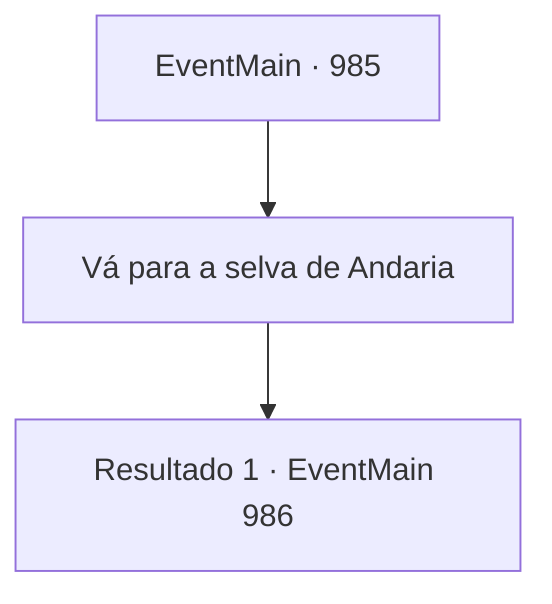

# Eventos principais · 985

[Índice da tabela](index.md) · [Índice geral](../index.md)

ID: `pt:EventMain:985` · Fonte: `EventMain4` · Versão: 1.2.47.

Mapeamento estático dos arquivos; a disponibilidade e a execução dependem do estado da run.

## Texto do evento

Você volta para Sinias e encontra Rosilpha. Lá, você conta o que aconteceu e os planos de Naverr. 

 "Hm... Entendi. Então, devemos seguir os planos de Naverr. Se essas coisas devem chegar a Andaria... A única coisa que precisamos fazer é nos preparar para lutar lá. Vamos."


## Dados de entrada

```json
{
  "id": 985,
  "grade": 1,
  "normalGoal": "",
  "required": "13_5_9|1_2_100"
}
```

## Mapa das escolhas



## Escolhas e resultados

### Escolha 1

Vá para a selva de Andaria

Requisitos e outros campos da escolha:

```json
{
  "required": ""
}
```

#### Resultado 1.1

Você e Rosilpha chegam ao Patinho Flutuante. Ao chegarem, alguns gripplis trabalhando na duckweed endireitam as costas e se levantam. Eles fazem um som de desaprovação para Rosilpha. 

 "Caminhando para lá e para cá, adiando a agricultura..."

 Há aquele que brigou com Rosilpha alguns dias atrás. Mas, ao contrário do que aconteceu antes, ele segue direto para a casa do ancião, sem dar atenção a eles.

Continuação registrada: [Evento 986](0986.md) na mesma tabela.

```json
{
  "required": "",
  "chance": "1",
  "nextEvent": 986,
  "type": 2,
  "reward": ""
}
```

## Referências que chegam a este evento

Nenhum `nextEvent` positivo da mesma tabela aponta para este nó. Isso não prova que seja inacessível: sorteio e estado de história podem selecioná-lo.

