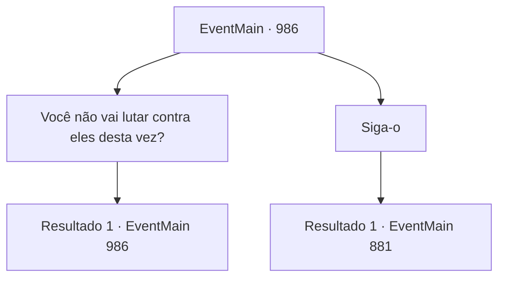

# Eventos principais · 986

[Índice da tabela](index.md) · [Índice geral](../index.md)

ID: `pt:EventMain:986` · Fonte: `EventMain4` · Versão: 1.2.47.

Mapeamento estático dos arquivos; a disponibilidade e a execução dependem do estado da run.

## Texto do evento

*Sem texto no arquivo.*

## Dados de entrada

```json
{
  "id": 986,
  "grade": 1,
  "normalGoal": "",
  "required": ""
}
```

## Mapa das escolhas



## Escolhas e resultados

### Escolha 1

Você não vai lutar contra eles desta vez?

Requisitos e outros campos da escolha:

```json
{
  "required": "5_674_0"
}
```

#### Resultado 1.1

Rosilpha respondeu, dando de ombros. 

 "Bem... Eu não me importo mais. Eles que são os infelizes. Estou focando em uma missão mais importante, qual é o sentido de lutar contra eles?"


Continuação registrada: [Evento 986](0986.md) na mesma tabela.

```json
{
  "required": "",
  "chance": "1",
  "nextEvent": 986,
  "type": 2,
  "reward": "5_674_1"
}
```

### Escolha 2

Siga-o

Requisitos e outros campos da escolha:

```json
{
  "required": ""
}
```

#### Resultado 2.1

Depois de Rosilpha, você segue para a casa do ancião grippli. Então você explica tudo para o ancião. Após ouvir que os devoradores de almas pegaram a Lente de Éter, e Naverr confiou o plano para capturá-los na fenda dimensional, o ancião responde, balançando a cabeça. 

 "Então eles virão aqui em breve. Devo consultar a Serpente Divina. Siga-me."

 O ancião grippli se apressa para fora com seu cajado. Após ele, você e Rosilpha chegam ao altar da Serpente Divina. Um totem de madeira da Serpente Divina está em pé, em um altar decorado com vários ossos de animais. 

 "Oh... Serpente Divina, governante de Andaria..! Por favor, responda ao meu chamado!"

 Enquanto o ancião oferece sacrifício e realiza o ritual, uma voz sai do totem. 

 "Sim... Então você descobriu algo."


Continuação registrada: [Evento 881](0881.md) na mesma tabela.

```json
{
  "required": "",
  "chance": "1",
  "nextEvent": 881,
  "type": 2,
  "reward": ""
}
```

## Referências que chegam a este evento

- [Evento 985 · escolha 1 · resultado 1](0985.md#escolha-1)
- [Evento 986 · escolha 1 · resultado 1](0986.md#escolha-1)
