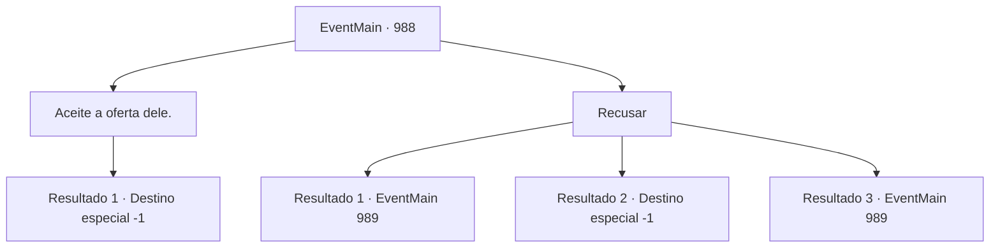

# Eventos principais · 988

[Índice da tabela](index.md) · [Índice geral](../index.md)

ID: `pt:EventMain:988` · Fonte: `EventMain4` · Versão: 1.2.47.

Mapeamento estático dos arquivos; a disponibilidade e a execução dependem do estado da run.

## Texto do evento

*Sem texto no arquivo.*

## Dados de entrada

```json
{
  "id": 988,
  "grade": 1,
  "normalGoal": "",
  "required": ""
}
```

## Mapa das escolhas



## Escolhas e resultados

### Escolha 1

Aceite a oferta dele.

Requisitos e outros campos da escolha:

```json
{
  "required": ""
}
```

#### Resultado 1.1

Você se aproxima da Rainha. Ela sorri gentilmente, segurando suas mãos. 

 "Fufu... Juntos, vamos quebrar esse ciclo. {1}."

 Assim que termina de falar, sua boca se divide em cruzes, revelando os tentáculos brancos. Eles se enterram em seu nariz, boca e ouvidos em apenas um segundo. A súbita onda de dor o deixa impotente para resistir. 

 "Agora. Você é um de nós."

 Assim, você perde sua mente e se torna um devoralmas.

Continuação registrada: [Destino especial `-1`](../destinos-especiais.md).

```json
{
  "required": "",
  "chance": "1",
  "nextEvent": -1,
  "type": 2,
  "reward": "15_6_4|25_8_1"
}
```

### Escolha 2

Recusar

Requisitos e outros campos da escolha:

```json
{
  "required": ""
}
```

#### Resultado 2.1

Você sente uma sensação de pressão do olhar da Rainha. Mas você não cede, recusando sua oferta. Então, devoradores de almas escondidos surgem atrás dela das árvores e arbustos. Eles te atacam imediatamente.

Continuação registrada: [Evento 989](0989.md) na mesma tabela.

```json
{
  "required": "24_7_1",
  "chance": "1|0_12_1",
  "nextEvent": 989,
  "type": 0,
  "reward": "6_3_169",
  "place": 1
}
```

#### Resultado 2.2

Você sente uma sensação de pressão do olhar da Rainha. Você não consegue recusar sua oferta. Ela sorri gentilmente, segurando suas mãos. 

 "Fufu... Juntos, vamos quebrar esse ciclo.{1}."

 Assim que termina de falar, sua boca se divide em cruzes, revelando os tentáculos brancos. Eles se enterram em seu nariz, boca e ouvidos em apenas um segundo. A súbita onda de dor o deixa impotente para resistir. 

 "Agora você é um de nós."

 Assim, você perde sua mente e se torna um devoralmas.

Continuação registrada: [Destino especial `-1`](../destinos-especiais.md).

```json
{
  "required": "24_7_1",
  "chance": "20",
  "nextEvent": -1,
  "type": 1,
  "reward": "15_6_4|25_8_1"
}
```

#### Resultado 2.3

Você sente uma sensação de pressão do olhar da Rainha. Mas você não cede, recusando sua oferta. Então, devoradores de almas escondidos surgem atrás dela das árvores e arbustos. Eles te atacam imediatamente.

Continuação registrada: [Evento 989](0989.md) na mesma tabela.

```json
{
  "required": "23_7_1",
  "chance": "1",
  "nextEvent": 989,
  "type": 2,
  "reward": "6_3_169",
  "place": 1
}
```

## Referências que chegam a este evento

- [Evento 987 · escolha 1 · resultado 2](0987.md#escolha-1)
- [Evento 987 · escolha 2 · resultado 1](0987.md#escolha-2)
