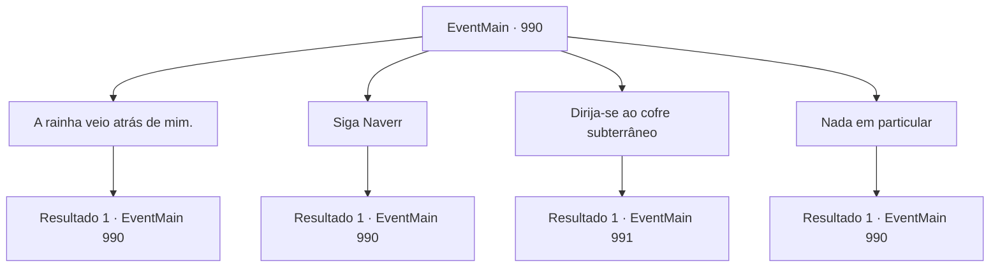

# Eventos principais · 990

[Índice da tabela](index.md) · [Índice geral](../index.md)

ID: `pt:EventMain:990` · Fonte: `EventMain4` · Versão: 1.2.47.

Mapeamento estático dos arquivos; a disponibilidade e a execução dependem do estado da run.

## Texto do evento

Após uma longa viagem, você finalmente chega a 'Viles', a cidade onde está localizada a Universidade de Brikkalua. Felizmente, o lugar parece tão pacífico quanto o dia em que você partiu. No caminho para o campus, você encontra Rosilpha e Naverr. Naverr te saúda alegremente. 

 "Bem-vindo. Você não encontrou devoradores de almas no caminho, certo? Estranho. Nenhum veio atrás de nós."


## Dados de entrada

```json
{
  "id": 990,
  "grade": 1,
  "normalGoal": "",
  "required": "13_5_102|1_2_100"
}
```

## Mapa das escolhas



## Escolhas e resultados

### Escolha 1

A rainha veio atrás de mim.

Requisitos e outros campos da escolha:

```json
{
  "required": "5_690_0|18_704_1"
}
```

#### Resultado 1.1

Você se lembra que já encontrou a Rainha dos devoradores de almas antes. Naverr inclina a cabeça, então fala. 

 "Hmm... Eles devem estar rastreando a Lente de Éter ou algo assim. Não tenho certeza de como, mas isso significa que eles estarão aqui em breve."

 Rosilpha acrescenta, concordando com ele. 

 "Vou contar isso ao ancião. Precisamos destruir esses artefatos."


Continuação registrada: [Evento 990](0990.md) na mesma tabela.

```json
{
  "required": "",
  "chance": "1",
  "nextEvent": 990,
  "type": 2,
  "reward": "5_690_1"
}
```

### Escolha 2

Siga Naverr

Requisitos e outros campos da escolha:

```json
{
  "required": "5_690_1"
}
```

#### Resultado 2.1

Você e Rosilpha seguem Naverr até o escritório do Diretor. O Diretor está descansando, tomando chá em seu sofá. Ele vê Naverr e pula de surpresa. 

 "Professor Naverr! ONDE VOCÊ ESTEVE?!"

 Naverr responde contando tudo o que aconteceu. Ele acrescenta que seu grupo veio a Brikkalua para selar a Lente de Éter. O Diretor o repreende por trazer um item tão perigoso para o campus, mas Naverr o ignora e insiste que ele ajude. 

 "O que realmente importa agora é selá-lo, Diretor."

 O Diretor concorda relutantemente. 

 "Arg. Vou fazer as perguntas depois. Venham, me sigam. O Cofre Subterrâneo deve servir."


Continuação registrada: [Evento 990](0990.md) na mesma tabela.

```json
{
  "required": "",
  "chance": "1",
  "nextEvent": 990,
  "type": 2,
  "reward": "5_690_2"
}
```

### Escolha 3

Dirija-se ao cofre subterrâneo

Requisitos e outros campos da escolha:

```json
{
  "required": "5_690_2"
}
```

#### Resultado 3.1

O Diretor lidera o caminho, com você, Naverr e Rosilpha seguindo atrás. Ele explica sobre o Cofre Subterrâneo no caminho. 

 "O Cofre Subterrâneo é construído com adamantium. Sem mencionar o feitiço de proteção indestrutível que é lançado sobre ele."

 Então, de repente, um barulho alto e uma faísca aparecem. 

 "O- O QUE ESTÁ ACONTECENDO...!?"

 Quando você olha para cima, avista o grotesco navio de batalha dos devoradores de almas flutuando no céu. Um poderoso bombardeio de energia é disparado de seus tentáculos. Explosões cobrem o campus de sujeira e detritos, enquanto a Universidade de Brikkalua se transforma em um campo de batalha. Devoradores de almas emergem da fumaça. Lá está também a Rainha, que você conheceu antes. Ela emite um forte senso de dominação, pressionando a todos. 

 "Vocês nos entregarão a Lente de Éter. Ou, todos aqui enfrentarão a morte."

 O Diretor, horrorizado, diz que você deve entregar o artefato.

Continuação registrada: [Evento 991](0991.md) na mesma tabela.

```json
{
  "required": "",
  "chance": "1",
  "nextEvent": 991,
  "type": 2,
  "reward": ""
}
```

### Escolha 4

Nada em particular

Requisitos e outros campos da escolha:

```json
{
  "required": "5_690_0|5_704_1"
}
```

#### Resultado 4.1

Você diz a ele que nada de estranho aconteceu. Naverr suspira aliviado. 

 "Isso é uma sorte... Venha. Precisamos ver o Diretor."


Continuação registrada: [Evento 990](0990.md) na mesma tabela.

```json
{
  "required": "",
  "chance": "1",
  "nextEvent": 990,
  "type": 2,
  "reward": "5_690_1"
}
```

## Referências que chegam a este evento

- [Evento 990 · escolha 1 · resultado 1](0990.md#escolha-1)
- [Evento 990 · escolha 2 · resultado 1](0990.md#escolha-2)
- [Evento 990 · escolha 4 · resultado 1](0990.md#escolha-4)
