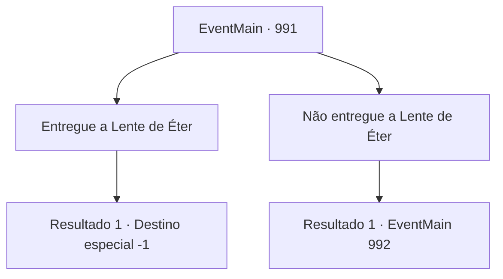

# Eventos principais · 991

[Índice da tabela](index.md) · [Índice geral](../index.md)

ID: `pt:EventMain:991` · Fonte: `EventMain4` · Versão: 1.2.47.

Mapeamento estático dos arquivos; a disponibilidade e a execução dependem do estado da run.

## Texto do evento

*Sem texto no arquivo.*

## Dados de entrada

```json
{
  "id": 991,
  "grade": 1,
  "normalGoal": "",
  "required": ""
}
```

## Mapa das escolhas



## Escolhas e resultados

### Escolha 1

Entregue a Lente de Éter

Requisitos e outros campos da escolha:

```json
{
  "required": ""
}
```

#### Resultado 1.1

Tendo perdido a vontade de lutar, você decide entregar a Lente de Éter. Naverr e Rosilpha tentam impedi-lo, mas não são rápidos o suficiente. Você se aproxima da Rainha e apresenta a Lente Ether. Com seu objetivo cumprido, a Rainha sorri gentilmente enquanto abraça suas mãos. 

 "Fufu... Uma escolha sábia, {1}. Eu lhe darei a honra de se tornar um de nós."

 Assim que termina de falar, sua boca se divide em cruzes, revelando os tentáculos brancos. Eles se enterram em seu nariz, boca e ouvidos em apenas um segundo. A súbita onda de dor o deixa impotente para resistir. 

 "Agora você é um de nós."

 Assim, você perde sua mente e se torna um devoralmas.

Continuação registrada: [Destino especial `-1`](../destinos-especiais.md).

```json
{
  "required": "",
  "chance": "1",
  "nextEvent": -1,
  "type": 2,
  "reward": "4_315_1|15_6_4|25_8_1|15_6_15"
}
```

### Escolha 2

Não entregue a Lente de Éter

Requisitos e outros campos da escolha:

```json
{
  "required": ""
}
```

#### Resultado 2.1

Você responde que não simplesmente entregará a Lente Ether. A Rainha franze a testa, e então ordena os devoradores de almas. É claro, a ordem é tomar a Lente Ether à força. Seguindo seu comando, os devoradores de almas começam seu ataque. Rosilpha luta rapidamente com seu arco, mas não consegue segurar todos eles. Naverr rapidamente agarra você pelos ombros e exclama. 

 "Isso não vai dar certo! Devemos nos separar. Uma equipe vai ganhar tempo aqui, e a outra deve ir para o Vault Subterrâneo e selar a Lente Ether!"

 Não há muito tempo para ponderar. Você sente o forte aperto de Naverr em você, como se estivesse instando você a fazer uma escolha.

Continuação registrada: [Evento 992](0992.md) na mesma tabela.

```json
{
  "required": "",
  "chance": "1",
  "nextEvent": 992,
  "type": 2,
  "reward": ""
}
```

## Referências que chegam a este evento

- [Evento 990 · escolha 3 · resultado 1](0990.md#escolha-3)
