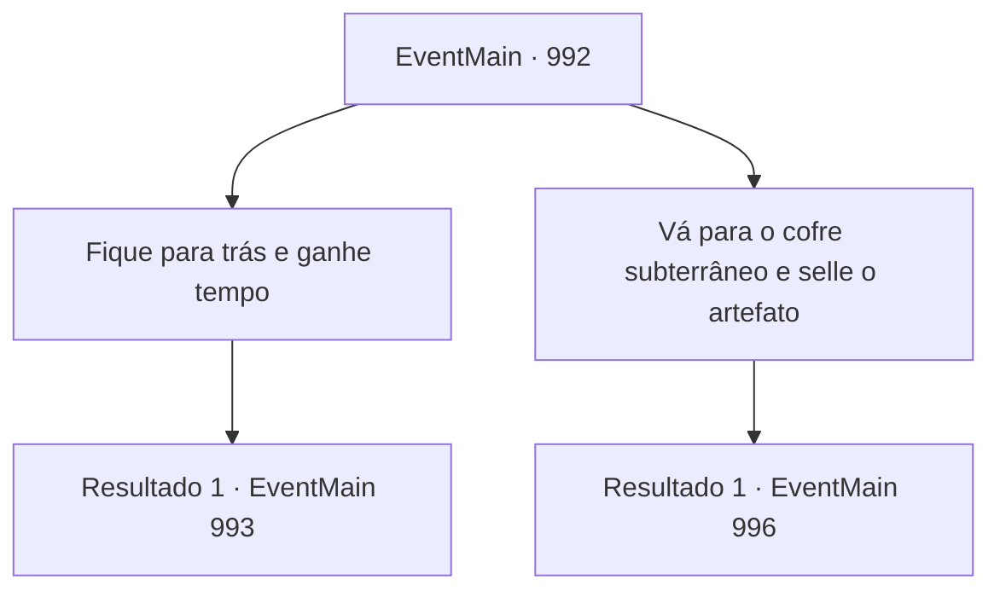

# Eventos principais · 992

[Índice da tabela](index.md) · [Índice geral](../index.md)

ID: `pt:EventMain:992` · Fonte: `EventMain4` · Versão: 1.2.47.

Mapeamento estático dos arquivos; a disponibilidade e a execução dependem do estado da run.

## Texto do evento

*Sem texto no arquivo.*

## Dados de entrada

```json
{
  "id": 992,
  "grade": 1,
  "normalGoal": "",
  "required": ""
}
```

## Mapa das escolhas



## Escolhas e resultados

### Escolha 1

Fique para trás e ganhe tempo

Requisitos e outros campos da escolha:

```json
{
  "required": ""
}
```

#### Resultado 1.1

Você dá a Naverr a Lente de Éter, encarregando-o de selá-la. Naverr, cheio de determinação, assente com a cabeça e corre para o Cofre Subterrâneo com o Diretor. Você se prepara para lutar com Rosilpha. Mesmo antes de estar pronto, os devoradores de almas ao redor começam seu ataque.

Continuação registrada: [Evento 993](0993.md) na mesma tabela.

```json
{
  "required": "",
  "chance": "1",
  "nextEvent": 993,
  "type": 2,
  "reward": "6_2_175|4_315_1",
  "place": 10
}
```

### Escolha 2

Vá para o cofre subterrâneo e selle o artefato

Requisitos e outros campos da escolha:

```json
{
  "required": ""
}
```

#### Resultado 2.1

Você decide ir até o cofre você mesmo e selar a Lente Ether. Naverr assente com a cabeça, então puxa seu facão. 

 "Então eu vou ficar aqui com Rosilpha e segurá-los. Depressa!"

 Você ajuda o Diretor a se levantar e corre para o Cofre Subterrâneo. 

 Este Cofre Subterrâneo não é um porão simples. Numerosos portões de proteção e escadas em espiral fazem dele um caminho longo e sinuoso. Quando vocês finalmente chegam, o lugar está cheio de estantes de livros, artefatos e poeira. 

 "*ofegante*... *ofegante*... Eu preciso abrir isso. Vai levar um tempo. Apenas aguente firme."

 O Diretor se aproxima do cofre de adamantina e começa a entoar um feitiço. Então, energia magia emana do cofre, revelando as runas que cobrem sua superfície. O cofre em si precisa ser desbloqueado para que o selamento ocorra. 

 "KIIIIIEEEEEE!!"

 Então, alguns poucos devoradores de almas que devem ter conseguido passar por Rosilpha e Naverr aparecem. Você olha para o Diretor. Parece que ele ainda precisa de mais tempo.

Continuação registrada: [Evento 996](0996.md) na mesma tabela.

```json
{
  "required": "",
  "chance": "1",
  "nextEvent": 996,
  "type": 2,
  "reward": ""
}
```

## Referências que chegam a este evento

- [Evento 991 · escolha 2 · resultado 1](0991.md#escolha-2)
