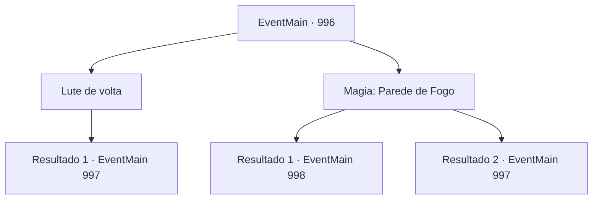

# Eventos principais · 996

[Índice da tabela](index.md) · [Índice geral](../index.md)

ID: `pt:EventMain:996` · Fonte: `EventMain4` · Versão: 1.2.47.

Mapeamento estático dos arquivos; a disponibilidade e a execução dependem do estado da run.

## Texto do evento

*Sem texto no arquivo.*

## Dados de entrada

```json
{
  "id": 996,
  "grade": 1,
  "normalGoal": "",
  "required": ""
}
```

## Mapa das escolhas



## Escolhas e resultados

### Escolha 1

Lute de volta

Requisitos e outros campos da escolha:

```json
{
  "required": ""
}
```

#### Resultado 1.1

Você decide fazer o que Rosilpha e Naverr fizeram - ganhar tempo. Você mantém sua posição, se preparando para lutar contra os devoradores de almas. Logo, uma onda inteira deles vem em sua direção.

Continuação registrada: [Evento 997](0997.md) na mesma tabela.

```json
{
  "required": "",
  "chance": "1",
  "nextEvent": 997,
  "type": 2,
  "reward": "6_2_175",
  "place": 10
}
```

### Escolha 2

Magia: Parede de Fogo

Requisitos e outros campos da escolha:

```json
{
  "required": "20_0_2|1_1_2"
}
```

#### Resultado 2.1

Você rapidamente lança um feitiço, impedindo os devoradores de almas de se aproximarem. As chamas ferozes bloqueiam os devoradores de almas, e os corajosos que decidiram correr para o fogo são rapidamente transformados em cinzas. Então, a Rainha aparece de trás deles. Ao dar um passo à frente, a parede de chamas é extinta. 

 "Vejo que você não é tão fraco quanto os outros. Eu irei acabar com você com minhas próprias mãos."|drawing_outerQueenTrue| As costas da Rainha se abrem, revelando sua verdadeira forma. Há um emaranhado de tentáculos de cor cinza claro que se parece com um cérebro enorme. Em sua superfície, algo brilhante está se movendo ao longo das veias sanguíneas, e abaixo disso, há inúmeros tentáculos com espinhos. A forma de uma bela dama está pendurada na parte inferior do enorme monte, como uma pituitária. A Rainha começa a atacar, agitando seus tentáculos em sua direção.

Continuação registrada: [Evento 998](0998.md) na mesma tabela.

```json
{
  "required": "",
  "chance": "1|0_7_1|0_12_1",
  "nextEvent": 998,
  "type": 0,
  "reward": "6_0_171",
  "place": 10
}
```

#### Resultado 2.2

Você tenta lançar um feitiço, mas os devoradores de almas são mais rápidos. Infelizmente, você decide desistir do feitiço e compensar com seu corpo. Você mantém sua posição, se preparando para lutar contra os devoradores de almas. Logo, uma onda inteira deles vem em sua direção.

Continuação registrada: [Evento 997](0997.md) na mesma tabela.

```json
{
  "required": "",
  "chance": "36",
  "nextEvent": 997,
  "type": 1,
  "reward": "6_0_175",
  "place": 10
}
```

## Referências que chegam a este evento

- [Evento 992 · escolha 2 · resultado 1](0992.md#escolha-2)
