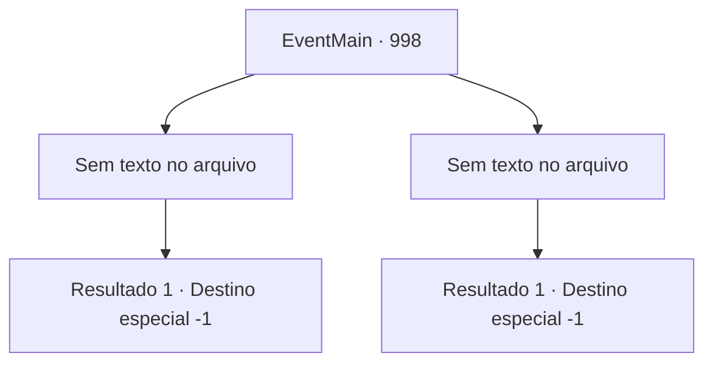

# Eventos principais · 998

[Índice da tabela](index.md) · [Índice geral](../index.md)

ID: `pt:EventMain:998` · Fonte: `EventMain4` · Versão: 1.2.47.

Mapeamento estático dos arquivos; a disponibilidade e a execução dependem do estado da run.

## Texto do evento

*Sem texto no arquivo.*

## Dados de entrada

```json
{
  "id": 998,
  "grade": 1,
  "normalGoal": "",
  "required": ""
}
```

## Mapa das escolhas



## Escolhas e resultados

### Escolha 1

*Sem texto no arquivo; o papel dessa opção depende da interface do jogo.*

Requisitos e outros campos da escolha:

```json
{
  "required": ""
}
```

#### Resultado 1.1

Seu golpe poderoso faz a Rainha cambalear. Você aproveita a oportunidade e desfere um golpe final, mas não atinge a Rainha. Um dos devoradores de almas se sacrifica para receber o golpe no lugar. Segurando a ferida, a Rainha exclama com fúria. 

 "Ah...! Isso... não é o fim...!!"

 Os devoradores de almas protegem a Rainha enquanto ela foge. Então, o Diretor se aproxima apressadamente e fala. 

 "A selagem está completa! Eles... foram embora?"

 O Diretor te dá tapinhas nas costas, elogiando o que você fez. Você sobe as escadas com o Diretor, para encontrar Rosilpha e Naverr e avisá-los de sua vitória. Mas o que você encontra são os corpos frios e sem vida de Rosilpha e Naverr. O Diretor desaba no chão, como um boneco sem cordas.

Continuação registrada: [Destino especial `-1`](../destinos-especiais.md).

```json
{
  "required": "",
  "chance": "1",
  "nextEvent": -1,
  "type": 2,
  "reward": "15_6_14|15_6_16|15_6_12|15_6_19"
}
```

### Escolha 2

*Sem texto no arquivo; o papel dessa opção depende da interface do jogo.*

Requisitos e outros campos da escolha:

```json
{
  "required": ""
}
```

#### Resultado 2.1

Os tentáculos da Rainha se lançam em sua direção. Você tenta desviar, mas a Rainha é mais rápida. Infelizmente, os tentáculos perfuram seu peito. A Rainha nem mesmo olha para você enquanto passa por você. 

 "O- o artefato já está selado! Vocês estão todos... AAAAAARRRGGGHHH!!"

 Em meio à consciência desaparecendo, você percebe o que parece ser o último suspiro do Diretor.

Continuação registrada: [Destino especial `-1`](../destinos-especiais.md).

```json
{
  "required": "",
  "chance": "1",
  "nextEvent": -1,
  "type": 2,
  "reward": "15_6_13|25_8_1"
}
```

## Referências que chegam a este evento

- [Evento 996 · escolha 2 · resultado 1](0996.md#escolha-2)
- [Evento 997 · escolha 1 · resultado 1](0997.md#escolha-1)
