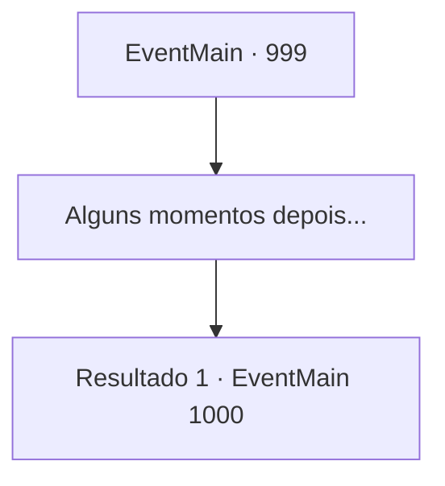

# Eventos principais · 999

[Índice da tabela](index.md) · [Índice geral](../index.md)

ID: `pt:EventMain:999` · Fonte: `EventMain4` · Versão: 1.2.47.

Mapeamento estático dos arquivos; a disponibilidade e a execução dependem do estado da run.

## Texto do evento

Você procura por Naverr aqui e ali, mas não encontra nada. Mas um dia, chega uma carta de Rosilpha. Apenas pela letra, você pode dizer que a carta foi escrita apressadamente.
 <i>'Volte para Sinias imediatamente! Isso é urgente!'</i> A carta insiste que você retorne a Sinias imediatamente. Você decide voltar para Sinias imediatamente.

## Dados de entrada

```json
{
  "id": 999,
  "grade": 1,
  "normalGoal": "",
  "required": "13_5_5|1_2_75"
}
```

## Mapa das escolhas



## Escolhas e resultados

### Escolha 1

Alguns momentos depois...

Requisitos e outros campos da escolha:

```json
{
  "required": ""
}
```

#### Resultado 1.1

Você finalmente chega em Sinias. Mas a cidade mudou - a atmosfera parece diferente. Não há guardas nos portões do castelo, nenhum civil entrando e saindo da cidade. Você entra pelo portão principal, que já está aberto, para ver o que aconteceu. A cidade está infestada de corpos sem cabeça, e uma horda de monstros distorcidos está devorando aqueles que ainda têm suas cabeças.

Continuação registrada: [Evento 1000](1000.md) na mesma tabela.

```json
{
  "required": "",
  "chance": "1",
  "nextEvent": 1000,
  "type": 2,
  "reward": ""
}
```

## Referências que chegam a este evento

Nenhum `nextEvent` positivo da mesma tabela aponta para este nó. Isso não prova que seja inacessível: sorteio e estado de história podem selecioná-lo.

