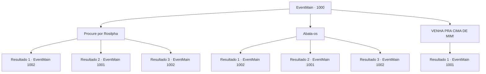

# Eventos principais · 1000

[Índice da tabela](index.md) · [Índice geral](../index.md)

ID: `pt:EventMain:1000` · Fonte: `EventMain4` · Versão: 1.2.47.

Mapeamento estático dos arquivos; a disponibilidade e a execução dependem do estado da run.

## Texto do evento

*Sem texto no arquivo.*

## Dados de entrada

```json
{
  "id": 1000,
  "grade": 1,
  "normalGoal": "",
  "required": ""
}
```

## Mapa das escolhas



## Escolhas e resultados

### Escolha 1

Procure por Rosilpha

Requisitos e outros campos da escolha:

```json
{
  "required": ""
}
```

#### Resultado 1.1

Você decide procurar Rosilpha primeiro. Depois de passar sorrateiramente pelos monstros, você procura por pistas dele, em cada canto da cidade. De repente, você ouve sua voz sussurrando. 

 "Aqui! Olhe aqui..."

 O local costumava ser uma estalagem - o prédio já está em ruínas, mas os destroços parecem estar servindo bem como abrigo. Rosilpha está sinalizando para você, de dentro dos destroços. Você se espreme através da abertura estreita. Isso deve ter sido a adega da estalagem antes.

Continuação registrada: [Evento 1002](1002.md) na mesma tabela.

```json
{
  "required": "21_5_4",
  "chance": "1|0_6_1",
  "nextEvent": 1002,
  "type": 0,
  "reward": ""
}
```

#### Resultado 1.2

Você decide procurar Rosilpha primeiro. Seu plano de passar despercebido pelos monstros é imediatamente frustrado, quando você pisa em um tijolo e ele se quebra. As criaturas param de devorar crânios, olhando para cima para você. Então, elas começam a correr em sua direção, sangue pingando de seus rostos e mãos.

Continuação registrada: [Evento 1001](1001.md) na mesma tabela.

```json
{
  "required": "21_5_4",
  "chance": "16",
  "nextEvent": 1001,
  "type": 1,
  "reward": "6_4_168",
  "place": 4
}
```

#### Resultado 1.3

Você decide procurar Rosilpha primeiro. Depois de passar sorrateiramente pelos monstros, você procura por pistas dele, em cada canto da cidade. De repente, você ouve sua voz sussurrando. 

 "Aqui! Olhe aqui..."

 O local costumava ser uma estalagem - o prédio já está em ruínas, mas os destroços parecem estar servindo bem como abrigo. Rosilpha está sinalizando para você, de dentro dos destroços. Você se espreme através da abertura estreita. Isso deve ter sido a adega da estalagem antes.

Continuação registrada: [Evento 1002](1002.md) na mesma tabela.

```json
{
  "required": "20_5_4",
  "chance": "1",
  "nextEvent": 1002,
  "type": 2,
  "reward": ""
}
```

### Escolha 2

Abata-os

Requisitos e outros campos da escolha:

```json
{
  "required": "20_6_1"
}
```

#### Resultado 2.1

Você mira cuidadosamente no monstro que está ocupado se alimentando. Você dispara um tiro, destruindo sua cabeça em uma única tentativa. Dois outros monstros também caem, incapazes de reagir aos tiros vindos do nada. Depois de se livrar deles, você procura em todos os cantos da cidade por pistas de Rosilpha. De repente, você ouve sua voz sussurrando. 

 "Aqui! Olhe aqui..."

 O local costumava ser uma estalagem - o prédio já está em ruínas, mas os destroços parecem estar servindo bem como abrigo. Rosilpha está sinalizando para você, de dentro dos destroços. Você se espreme através da abertura estreita. Isso deve ter sido a adega da estalagem antes.

Continuação registrada: [Evento 1002](1002.md) na mesma tabela.

```json
{
  "required": "21_6_3",
  "chance": "1|0_6_1",
  "nextEvent": 1002,
  "type": 0,
  "reward": ""
}
```

#### Resultado 2.2

Você mira cuidadosamente no monstro que está ocupado se alimentando. Você dispara um tiro, mas erra. As criaturas param de devorar crânios, olhando para cima para você. Então, elas começam a correr em sua direção, sangue escorrendo de seus rostos e mãos.

Continuação registrada: [Evento 1001](1001.md) na mesma tabela.

```json
{
  "required": "21_6_3",
  "chance": "26",
  "nextEvent": 1001,
  "type": 1,
  "reward": "6_4_168",
  "place": 4
}
```

#### Resultado 2.3

Você mira cuidadosamente no monstro que está ocupado se alimentando. Você dispara um tiro, destruindo sua cabeça em uma única tentativa. Dois outros monstros também caem, incapazes de reagir aos tiros vindos do nada. Depois de se livrar deles, você procura em todos os cantos da cidade por pistas de Rosilpha. De repente, você ouve sua voz sussurrando. 

 "Aqui! Olhe aqui..."

 O local costumava ser uma estalagem - o prédio já está em ruínas, mas os destroços parecem estar servindo bem como abrigo. Rosilpha está sinalizando para você, de dentro dos destroços. Você se espreme através da abertura estreita. Isso deve ter sido a adega da estalagem antes.

Continuação registrada: [Evento 1002](1002.md) na mesma tabela.

```json
{
  "required": "20_6_3",
  "chance": "1",
  "nextEvent": 1002,
  "type": 2,
  "reward": ""
}
```

### Escolha 3

VENHA PRA CIMA DE MIM!

Requisitos e outros campos da escolha:

```json
{
  "required": ""
}
```

#### Resultado 3.1

Você os provoca em voz alta. As criaturas param de devorar crânios, olhando para cima para você. Então, elas começam a correr em sua direção, sangue pingando de seus rostos e mãos.

Continuação registrada: [Evento 1001](1001.md) na mesma tabela.

```json
{
  "required": "",
  "chance": "1",
  "nextEvent": 1001,
  "type": 2,
  "reward": "6_4_168",
  "place": 4
}
```

## Referências que chegam a este evento

- [Evento 999 · escolha 1 · resultado 1](0999.md#escolha-1)
