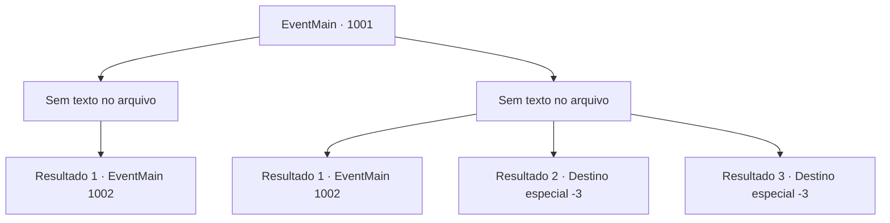

# Eventos principais · 1001

[Índice da tabela](index.md) · [Índice geral](../index.md)

ID: `pt:EventMain:1001` · Fonte: `EventMain4` · Versão: 1.2.47.

Mapeamento estático dos arquivos; a disponibilidade e a execução dependem do estado da run.

## Texto do evento

*Sem texto no arquivo.*

## Dados de entrada

```json
{
  "id": 1001,
  "grade": 1,
  "normalGoal": "",
  "required": ""
}
```

## Mapa das escolhas



## Escolhas e resultados

### Escolha 1

*Sem texto no arquivo; o papel dessa opção depende da interface do jogo.*

Requisitos e outros campos da escolha:

```json
{
  "required": ""
}
```

#### Resultado 1.1

Você envia os monstros para a morte. Depois de se livrar deles, você procura em todos os cantos da cidade por pistas de Rosilpha. De repente, você ouve sua voz sussurrando. 

 "Aqui! Olhe aqui..."

 O local costumava ser uma estalagem - o prédio já está em ruínas, mas os destroços parecem estar servindo bem como abrigo. Rosilpha está sinalizando para você, de dentro dos destroços. Você se espreme através da estreita abertura. Isso deve ter sido a adega da estalagem antes.

Continuação registrada: [Evento 1002](1002.md) na mesma tabela.

```json
{
  "required": "",
  "chance": "1",
  "nextEvent": 1002,
  "type": 2,
  "reward": ""
}
```

### Escolha 2

*Sem texto no arquivo; o papel dessa opção depende da interface do jogo.*

Requisitos e outros campos da escolha:

```json
{
  "required": ""
}
```

#### Resultado 2.1

Você está agarrado pelos tentáculos do monstro. Assim que você está prestes a ser devorado pelos dentes afiados do tentáculo, uma flecha perfura sua cabeça. 

 "AQUI! VENHA AQUI!"

 A flecha é de Rosilpha. Ele está chamando você, empoleirado no topo dos destroços de uma estalagem. O prédio já está em ruínas, mas os destroços parecem estar servindo bem como abrigo. Você se espreme através da abertura estreita. Isso deve ter sido a adega da estalagem antes.

Continuação registrada: [Evento 1002](1002.md) na mesma tabela.

```json
{
  "required": "1_0_2|1_1_2",
  "chance": "1",
  "nextEvent": 1002,
  "type": 2,
  "reward": "0_0_-1|0_1_-1"
}
```

#### Resultado 2.2

Você está agarrado pelas tentáculos do monstro. Os dentes do tentáculo vêm atrás do seu crânio desta vez. Assim, você se junta à coleção de cadáveres decapitados da cidade.

Continuação registrada: [Destino especial `-3`](../destinos-especiais.md).

```json
{
  "required": "2_0_2",
  "chance": "1",
  "nextEvent": -3,
  "type": 2,
  "reward": "0_0_-1|0_1_-1"
}
```

#### Resultado 2.3

Você está agarrado pelas tentáculos do monstro. Os dentes do tentáculo vêm atrás do seu crânio desta vez. Assim, você se junta à coleção de cadáveres decapitados da cidade.

Continuação registrada: [Destino especial `-3`](../destinos-especiais.md).

```json
{
  "required": "2_1_2",
  "chance": "1",
  "nextEvent": -3,
  "type": 2,
  "reward": "0_0_-1|0_1_-1"
}
```

## Referências que chegam a este evento

- [Evento 1000 · escolha 1 · resultado 2](1000.md#escolha-1)
- [Evento 1000 · escolha 2 · resultado 2](1000.md#escolha-2)
- [Evento 1000 · escolha 3 · resultado 1](1000.md#escolha-3)
