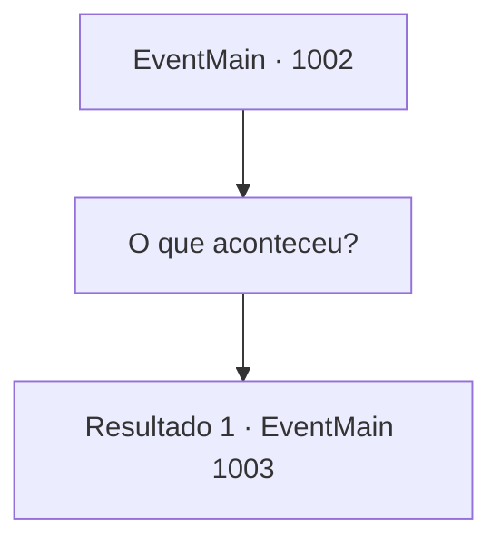

# Eventos principais · 1002

[Índice da tabela](index.md) · [Índice geral](../index.md)

ID: `pt:EventMain:1002` · Fonte: `EventMain4` · Versão: 1.2.47.

Mapeamento estático dos arquivos; a disponibilidade e a execução dependem do estado da run.

## Texto do evento

*Sem texto no arquivo.*

## Dados de entrada

```json
{
  "id": 1002,
  "grade": 1,
  "normalGoal": "",
  "required": ""
}
```

## Mapa das escolhas



## Escolhas e resultados

### Escolha 1

O que aconteceu?

Requisitos e outros campos da escolha:

```json
{
  "required": ""
}
```

#### Resultado 1.1

Você pergunta a Rosilpha o que aconteceu. Rosilpha sussurra em resposta. 

 "Pouco depois de você sair, aqueles cabeças de lula começaram a cair do céu. Quando olhei para o céu, havia uma água-viva gigante flutuando nele. Então, bem... Você já viu o que aconteceu com a cidade."

 Ele acrescenta que mal conseguiu se esconder dos monstros, se escondendo neste lugar.

Continuação registrada: [Evento 1003](1003.md) na mesma tabela.

```json
{
  "required": "",
  "chance": "1",
  "nextEvent": 1003,
  "type": 2,
  "reward": ""
}
```

## Referências que chegam a este evento

- [Evento 1000 · escolha 1 · resultado 1](1000.md#escolha-1)
- [Evento 1000 · escolha 1 · resultado 3](1000.md#escolha-1)
- [Evento 1000 · escolha 2 · resultado 1](1000.md#escolha-2)
- [Evento 1000 · escolha 2 · resultado 3](1000.md#escolha-2)
- [Evento 1001 · escolha 1 · resultado 1](1001.md#escolha-1)
- [Evento 1001 · escolha 2 · resultado 1](1001.md#escolha-2)
