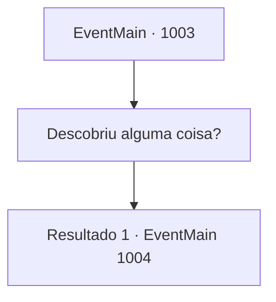

# Eventos principais · 1003

[Índice da tabela](index.md) · [Índice geral](../index.md)

ID: `pt:EventMain:1003` · Fonte: `EventMain4` · Versão: 1.2.47.

Mapeamento estático dos arquivos; a disponibilidade e a execução dependem do estado da run.

## Texto do evento

*Sem texto no arquivo.*

## Dados de entrada

```json
{
  "id": 1003,
  "grade": 1,
  "normalGoal": "",
  "required": ""
}
```

## Mapa das escolhas



## Escolhas e resultados

### Escolha 1

Descobriu alguma coisa?

Requisitos e outros campos da escolha:

```json
{
  "required": ""
}
```

#### Resultado 1.1

Rosilpha balança a cabeça em resposta. 

 "Claro. Eu os observei, se movendo de um lugar para outro."

 Rosilpha diz que, com base no que viu, os monstros devem estar procurando algo na cidade. 

 "Ah, e... Os monstros também têm Naverr. Não apenas Naverr - não consigo dizer por que, mas eles estão mantendo pessoas como reféns."


Continuação registrada: [Evento 1004](1004.md) na mesma tabela.

```json
{
  "required": "",
  "chance": "1",
  "nextEvent": 1004,
  "type": 2,
  "reward": ""
}
```

## Referências que chegam a este evento

- [Evento 1002 · escolha 1 · resultado 1](1002.md#escolha-1)
