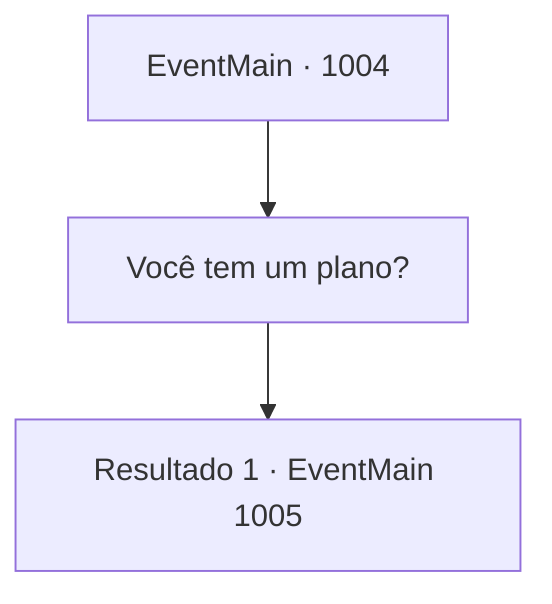

# Eventos principais · 1004

[Índice da tabela](index.md) · [Índice geral](../index.md)

ID: `pt:EventMain:1004` · Fonte: `EventMain4` · Versão: 1.2.47.

Mapeamento estático dos arquivos; a disponibilidade e a execução dependem do estado da run.

## Texto do evento

*Sem texto no arquivo.*

## Dados de entrada

```json
{
  "id": 1004,
  "grade": 1,
  "normalGoal": "",
  "required": ""
}
```

## Mapa das escolhas



## Escolhas e resultados

### Escolha 1

Você tem um plano?

Requisitos e outros campos da escolha:

```json
{
  "required": ""
}
```

#### Resultado 1.1

Rosilpha responde confiantemente. 

 "Há alguns dias, descobri onde estão mantendo as pessoas presas. Devemos ser capazes de encontrar Naverr e outras pessoas lá. Minha sugestão é que vamos lá primeiro."

 Segundo ele, a prisão fica dentro de uma mansão com domo roxo na Cidade Alta. No entanto, a única maneira de chegar à Cidade Alta é pela famosa 'Escadaria da Lei', que foi destruída durante a invasão dos monstros. 

 "Então... precisamos encontrar outra maneira de chegar à Cidade Alta. Podemos voar, ou construir uma escadaria improvisada com alguns materiais, algo assim."

 Você segue Rosilpha até o que resta das escadas. A escadaria, lindamente decorada com mármore e cobre, mal está de pé, completamente desequilibrada. Para chegar à Cidade Alta, você terá que atravessar esse enorme vão, pelo menos cinco vezes a sua altura.

Continuação registrada: [Evento 1005](1005.md) na mesma tabela.

```json
{
  "required": "",
  "chance": "1",
  "nextEvent": 1005,
  "type": 2,
  "reward": ""
}
```

## Referências que chegam a este evento

- [Evento 1003 · escolha 1 · resultado 1](1003.md#escolha-1)
