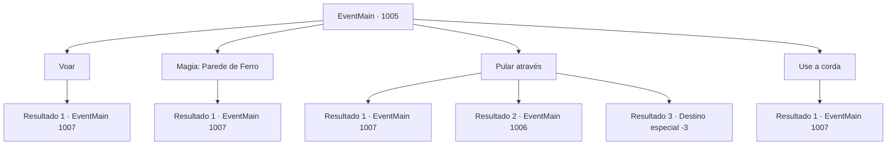

# Eventos principais · 1005

[Índice da tabela](index.md) · [Índice geral](../index.md)

ID: `pt:EventMain:1005` · Fonte: `EventMain4` · Versão: 1.2.47.

Mapeamento estático dos arquivos; a disponibilidade e a execução dependem do estado da run.

## Texto do evento

*Sem texto no arquivo.*

## Dados de entrada

```json
{
  "id": 1005,
  "grade": 1,
  "normalGoal": "",
  "required": ""
}
```

## Mapa das escolhas



## Escolhas e resultados

### Escolha 1

Voar

Requisitos e outros campos da escolha:

```json
{
  "required": "-1|20_10_1|20_0_2"
}
```

#### Resultado 1.1

Você pega as mãos de Rosilpha e sobe ao ar. Os dois atravessam com segurança as escadas cortadas. 

 "Obrigado por isso. Não poderia ter sido mais fácil. Agora... ali. É o casarão que eu estava falando."

 Você olha para onde Rosilpha está apontando. A cúpula roxa entra em sua visão. Lá estão os monstros que você viu antes, guardando o caminho para o casarão.

Continuação registrada: [Evento 1007](1007.md) na mesma tabela.

```json
{
  "required": "",
  "chance": "1",
  "nextEvent": 1007,
  "type": 2,
  "reward": ""
}
```

### Escolha 2

Magia: Parede de Ferro

Requisitos e outros campos da escolha:

```json
{
  "required": "20_0_3|1_1_2"
}
```

#### Resultado 2.1

Você preenche a lacuna conjurando uma parede de metal com magia. Os dois atravessam com segurança as escadas cortadas. 

 "Obrigado por isso. Não poderia ter sido mais fácil. Agora... ali. Aquela é a mansão da qual eu estava falando."

 Você olha para onde Rosilpha está apontando. A cúpula roxa entra em sua visão. Lá estão os monstros que você viu antes, guardando o caminho para a mansão.

Continuação registrada: [Evento 1007](1007.md) na mesma tabela.

```json
{
  "required": "",
  "chance": "1",
  "nextEvent": 1007,
  "type": 2,
  "reward": "0_1_-1"
}
```

### Escolha 3

Pular através

Requisitos e outros campos da escolha:

```json
{
  "required": ""
}
```

#### Resultado 3.1

Você carrega Rosilpha em seus ombros e pula. Você consegue alcançar o outro lado. 

 "...Nossa, pensei que íamos morrer com certeza."

 Rosilpha solta um suspiro de alívio e continua. 

 "*ufa*.. Agora... ali. Aquela é a mansão que eu estava falando."

 Você olha para onde Rosilpha está apontando. A cúpula roxa entra em sua visão. Lá estão os monstros que você viu antes, guardando o caminho para a mansão.

Continuação registrada: [Evento 1007](1007.md) na mesma tabela.

```json
{
  "required": "",
  "chance": "1|0_5_1",
  "nextEvent": 1007,
  "type": 0,
  "reward": ""
}
```

#### Resultado 3.2

Você carrega Rosilpha em seus ombros e pula. Mas você não consegue alcançar o outro lado. 

 "UUUUWWWAAAA--!!"

 Você e Rosilpha caem escada abaixo, entrando em contato com o chão com um estrondo alto. Você engole a dor, mal, e se levanta. Rosilpha tenta se levantar também enquanto reclama. 

 "Ugh... Droga, se soubesse que isso ia acontecer, teria descido as escadas logo de cara. Bem, agora não temos escolha a não ser subir."


Continuação registrada: [Evento 1006](1006.md) na mesma tabela.

```json
{
  "required": "1_0_2",
  "chance": "16",
  "nextEvent": 1006,
  "type": 1,
  "reward": "0_0_-1"
}
```

#### Resultado 3.3

Você carrega Rosilpha em seus ombros e pula. Mas você não consegue alcançar o outro lado. 

 "UUUUWWWAAAA--!!"

 Você e Rosilpha caem escada abaixo, entrando em contato com o chão com um estrondo alto. Infelizmente, seu pescoço quebra.

Continuação registrada: [Destino especial `-3`](../destinos-especiais.md).

```json
{
  "required": "2_0_2",
  "chance": "16",
  "nextEvent": -3,
  "type": 1,
  "reward": "0_0_-1"
}
```

### Escolha 4

Use a corda

Requisitos e outros campos da escolha:

```json
{
  "required": "8_39_1"
}
```

#### Resultado 4.1

Você utiliza cordas, atravessando com segurança a ponte cortada. 

 "Obrigado por isso. Não poderia ter feito mais fácil. Agora... ali. Aquela é a mansão da qual eu estava falando."

 Você olha para onde Rosilpha está apontando. A cúpula roxa entra em sua visão. Lá estão os monstros que você viu antes, guardando o caminho para a mansão.

Continuação registrada: [Evento 1007](1007.md) na mesma tabela.

```json
{
  "required": "",
  "chance": "1",
  "nextEvent": 1007,
  "type": 2,
  "reward": ""
}
```

## Referências que chegam a este evento

- [Evento 1004 · escolha 1 · resultado 1](1004.md#escolha-1)
