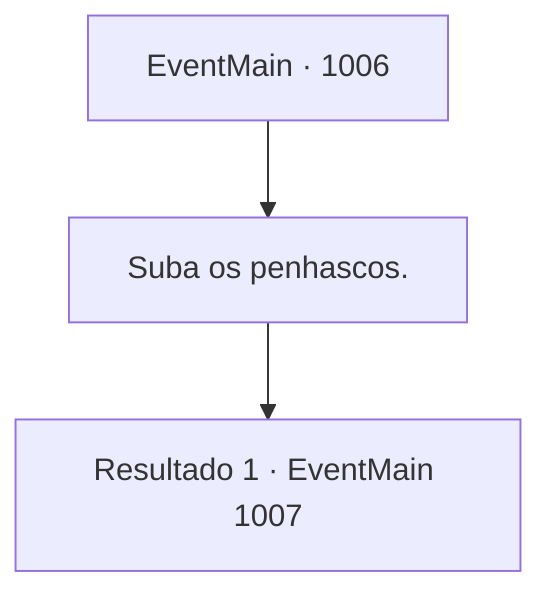

# Eventos principais · 1006

[Índice da tabela](index.md) · [Índice geral](../index.md)

ID: `pt:EventMain:1006` · Fonte: `EventMain4` · Versão: 1.2.47.

Mapeamento estático dos arquivos; a disponibilidade e a execução dependem do estado da run.

## Texto do evento

*Sem texto no arquivo.*

## Dados de entrada

```json
{
  "id": 1006,
  "grade": 1,
  "normalGoal": "",
  "required": ""
}
```

## Mapa das escolhas



## Escolhas e resultados

### Escolha 1

Suba os penhascos.

Requisitos e outros campos da escolha:

```json
{
  "required": ""
}
```

#### Resultado 1.1

Você e Rosilpha sobem os penhascos rochosos, chegando à Cidade Alta. Ele então exige que vocês dois se apressem, dizendo que tempo suficiente foi perdido subindo. 

 "Agora, ali... É o casarão sobre o qual eu estava falando."

 Você olha para onde Rosilpha está apontando. A cúpula roxa entra em sua visão. Lá estão os monstros que você viu antes, guardando o caminho para o casarão.

Continuação registrada: [Evento 1007](1007.md) na mesma tabela.

```json
{
  "required": "",
  "chance": "1",
  "nextEvent": 1007,
  "type": 2,
  "reward": ""
}
```

## Referências que chegam a este evento

- [Evento 1005 · escolha 3 · resultado 2](1005.md#escolha-3)
