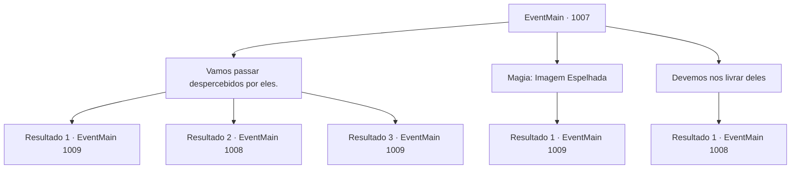

# Eventos principais · 1007

[Índice da tabela](index.md) · [Índice geral](../index.md)

ID: `pt:EventMain:1007` · Fonte: `EventMain4` · Versão: 1.2.47.

Mapeamento estático dos arquivos; a disponibilidade e a execução dependem do estado da run.

## Texto do evento

*Sem texto no arquivo.*

## Dados de entrada

```json
{
  "id": 1007,
  "grade": 1,
  "normalGoal": "",
  "required": ""
}
```

## Mapa das escolhas



## Escolhas e resultados

### Escolha 1

Vamos passar despercebidos por eles.

Requisitos e outros campos da escolha:

```json
{
  "required": ""
}
```

#### Resultado 1.1

Você e Rosilpha se aproximam cuidadosamente dos cabeças de lula, evitando sua visão. Finalmente, você chega à mansão, apenas para descobrir que o domo roxo não é um domo - é parte da nave de batalha semelhante a uma água-viva em que os monstros estavam. Rosilpha olha, sussurrando. 

 "Vamos salvar as pessoas lá dentro, encontrar Naverr e sair."

 Ao abrir a porta principal decorada e entrar, você encontra tentáculos roxos enroscados em toda a propriedade, cheia de moradores locais. Eles estão reagindo de maneira diferente à situação - alguns estão elogiando os monstros em voz alta, alguns estão chorando copiosamente e alguns estão encolhidos no canto, congelados de medo. Alguns infelizes já perderam a cabeça. No meio deles, você encontra Naverr. Ele está caído no chão, olhando fixamente para o vazio.

Continuação registrada: [Evento 1009](1009.md) na mesma tabela.

```json
{
  "required": "",
  "chance": "1|0_5_1",
  "nextEvent": 1009,
  "type": 0,
  "reward": ""
}
```

#### Resultado 1.2

Você e Rosilpha tentam se mover cuidadosamente ao redor das cabeças de lula, evitando sua visão. Mas você acaba pisando em um rato sem nem perceber. O rato emite um grito de dor, chamando a atenção dos monstros para você. 

 "...Oh não."

 Rosilpha exclama, enquanto uma batalha começa.

Continuação registrada: [Evento 1008](1008.md) na mesma tabela.

```json
{
  "required": "",
  "chance": "20",
  "nextEvent": 1008,
  "type": 1,
  "reward": "6_4_168",
  "place": 4
}
```

#### Resultado 1.3

Você e Rosilpha se aproximam cuidadosamente dos cabeças de lula, evitando sua visão. Finalmente, você chega à mansão, apenas para descobrir que o domo roxo não é um domo - é parte da nave de batalha semelhante a uma água-viva em que os monstros estavam. Rosilpha olha, sussurrando. 

 "Vamos salvar as pessoas lá dentro, encontrar Naverr e sair."

 Ao abrir a porta principal decorada e entrar, você encontra tentáculos roxos enroscados em toda a propriedade, cheia de moradores locais. Eles estão reagindo de maneira diferente à situação - alguns estão elogiando os monstros em voz alta, alguns estão chorando copiosamente e alguns estão encolhidos no canto, congelados de medo. Alguns infelizes já perderam a cabeça. No meio deles, você encontra Naverr. Ele está caído no chão, olhando fixamente para o vazio.

Continuação registrada: [Evento 1009](1009.md) na mesma tabela.

```json
{
  "required": "20_5_4",
  "chance": "1|0_5_1",
  "nextEvent": 1009,
  "type": 0,
  "reward": ""
}
```

### Escolha 2

Magia: Imagem Espelhada

Requisitos e outros campos da escolha:

```json
{
  "required": "20_0_1|1_1_2"
}
```

#### Resultado 2.1

Você usa sua magia para desviar a atenção deles. Os monstros começam a perseguir seus duplicados, enquanto você e Rosilpha correm em direção ao casarão. Finalmente, você chega ao casarão, apenas para descobrir que a cúpula roxa não é uma cúpula - é parte da nave de batalha semelhante a uma água-viva em que os monstros estavam. Rosilpha encara, sussurrando. 

 "Vamos salvar as pessoas lá dentro, encontrar Naverr e sair."

 Ao abrir a porta principal decorada e entrar, você encontra tentáculos roxos enroscados em toda a propriedade, cheia de moradores locais. Eles estão reagindo de maneira diferente à situação - alguns estão elogiando os monstros em voz alta, alguns estão chorando copiosamente, e alguns estão encolhidos no canto, congelados de medo. Alguns infelizes já perderam a cabeça. No meio deles, você encontra Naverr. Ele está caído no chão, encarando o vazio sem expressão.

Continuação registrada: [Evento 1009](1009.md) na mesma tabela.

```json
{
  "required": "",
  "chance": "1",
  "nextEvent": 1009,
  "type": 2,
  "reward": "0_1_-1"
}
```

### Escolha 3

Devemos nos livrar deles

Requisitos e outros campos da escolha:

```json
{
  "required": ""
}
```

#### Resultado 3.1

Você imediatamente avança contra os monstros. Rosilpha faz o mesmo, preparando suas flechas.

Continuação registrada: [Evento 1008](1008.md) na mesma tabela.

```json
{
  "required": "",
  "chance": "1",
  "nextEvent": 1008,
  "type": 2,
  "reward": "6_4_168",
  "place": 4
}
```

## Referências que chegam a este evento

- [Evento 1005 · escolha 1 · resultado 1](1005.md#escolha-1)
- [Evento 1005 · escolha 2 · resultado 1](1005.md#escolha-2)
- [Evento 1005 · escolha 3 · resultado 1](1005.md#escolha-3)
- [Evento 1005 · escolha 4 · resultado 1](1005.md#escolha-4)
- [Evento 1006 · escolha 1 · resultado 1](1006.md#escolha-1)
