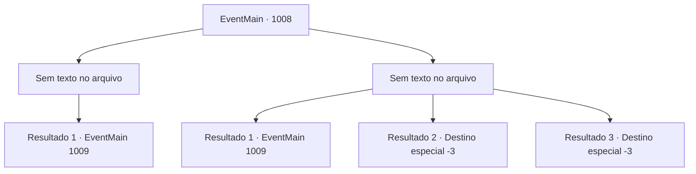

# Eventos principais · 1008

[Índice da tabela](index.md) · [Índice geral](../index.md)

ID: `pt:EventMain:1008` · Fonte: `EventMain4` · Versão: 1.2.47.

Mapeamento estático dos arquivos; a disponibilidade e a execução dependem do estado da run.

## Texto do evento

*Sem texto no arquivo.*

## Dados de entrada

```json
{
  "id": 1008,
  "grade": 1,
  "normalGoal": "",
  "required": ""
}
```

## Mapa das escolhas



## Escolhas e resultados

### Escolha 1

*Sem texto no arquivo; o papel dessa opção depende da interface do jogo.*

Requisitos e outros campos da escolha:

```json
{
  "required": ""
}
```

#### Resultado 1.1

Você e Rosilpha dominam os guardas cabeça de lula, então seguem direto para o casarão. Finalmente, você chega ao casarão, apenas para descobrir que a cúpula roxa não é uma cúpula - é parte da nave de batalha semelhante a uma água-viva em que os monstros estavam. Rosilpha encara, sussurrando. 

 "Vamos salvar as pessoas lá dentro, encontrar Naverr e sair."

 Ao abrir a porta principal decorada e entrar, você encontra tentáculos roxos enroscados em toda a propriedade, cheia de moradores locais. Eles estão reagindo de maneira diferente à situação - alguns estão elogiando os monstros em voz alta, alguns estão chorando copiosamente, e alguns estão encolhidos no canto, congelados de medo. Alguns infelizes já perderam a cabeça. No meio deles, você encontra Naverr. Ele está caído no chão, encarando o vazio sem expressão.

Continuação registrada: [Evento 1009](1009.md) na mesma tabela.

```json
{
  "required": "",
  "chance": "1",
  "nextEvent": 1009,
  "type": 2,
  "reward": ""
}
```

### Escolha 2

*Sem texto no arquivo; o papel dessa opção depende da interface do jogo.*

Requisitos e outros campos da escolha:

```json
{
  "required": ""
}
```

#### Resultado 2.1

Você está ferido na batalha, mas com a ajuda de Rosilpha, consegue dominar os monstros. Finalmente, você chega à mansão, apenas para descobrir que a cúpula roxa não é uma cúpula - é parte da nave de batalha semelhante a uma água-viva em que os monstros estavam. Rosilpha encara, sussurrando. 

 "Vamos salvar as pessoas lá dentro, encontrar Naverr e sair."

 Ao abrir a porta principal decorada e entrar, você encontra tentáculos roxos enroscados em toda a propriedade, cheia de moradores locais. Eles estão reagindo de maneira diferente à situação - alguns estão elogiando os monstros em voz alta, outros estão chorando copiosamente, e alguns estão encolhidos no canto, congelados de medo. Alguns infelizes já perderam a cabeça. No meio deles, você encontra Naverr. Ele está caído no chão, encarando o vazio sem expressão.

Continuação registrada: [Evento 1009](1009.md) na mesma tabela.

```json
{
  "required": "1_0_2|1_1_2",
  "chance": "1",
  "nextEvent": 1009,
  "type": 2,
  "reward": "0_0_-1|0_1_-1"
}
```

#### Resultado 2.2

Você é pego pelos tentáculos dos monstros. Eles vão direto para o seu crânio. Você não tem escolha a não ser se juntar aos cadáveres sem cabeça espalhados ao seu redor.

Continuação registrada: [Destino especial `-3`](../destinos-especiais.md).

```json
{
  "required": "2_0_2",
  "chance": "1",
  "nextEvent": -3,
  "type": 2,
  "reward": "0_0_-1|0_1_-1"
}
```

#### Resultado 2.3

Você é pego pelos tentáculos dos monstros. Eles vão direto para o seu crânio. Você não tem escolha a não ser se juntar aos cadáveres sem cabeça espalhados ao seu redor.

Continuação registrada: [Destino especial `-3`](../destinos-especiais.md).

```json
{
  "required": "2_1_2",
  "chance": "1",
  "nextEvent": -3,
  "type": 2,
  "reward": "0_0_-1|0_1_-1"
}
```

## Referências que chegam a este evento

- [Evento 1007 · escolha 1 · resultado 2](1007.md#escolha-1)
- [Evento 1007 · escolha 3 · resultado 1](1007.md#escolha-3)
