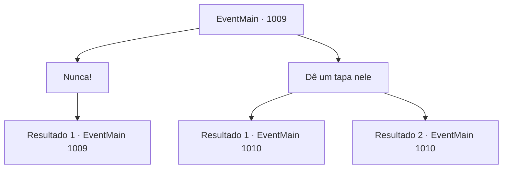

# Eventos principais · 1009

[Índice da tabela](index.md) · [Índice geral](../index.md)

ID: `pt:EventMain:1009` · Fonte: `EventMain4` · Versão: 1.2.47.

Mapeamento estático dos arquivos; a disponibilidade e a execução dependem do estado da run.

## Texto do evento

*Sem texto no arquivo.*

## Dados de entrada

```json
{
  "id": 1009,
  "grade": 1,
  "normalGoal": "",
  "required": ""
}
```

## Mapa das escolhas



## Escolhas e resultados

### Escolha 1

Nunca!

Requisitos e outros campos da escolha:

```json
{
  "required": "5_694_0"
}
```

#### Resultado 1.1

|drawing_naverrFace| Você e Rosilpha se aproximam de Naverr e chamam seu nome. Ele apenas fica lá, sem palavras. Não importa quantas vezes você o chame, ele não responde. 

 "Parece que ele está fora de si. Devemos encontrar outro caminho."


Continuação registrada: [Evento 1009](1009.md) na mesma tabela.

```json
{
  "required": "",
  "chance": "1",
  "nextEvent": 1009,
  "type": 2,
  "reward": "5_694_1"
}
```

### Escolha 2

Dê um tapa nele

Requisitos e outros campos da escolha:

```json
{
  "required": ""
}
```

#### Resultado 2.1

Você arregaça as mangas e dá tapas nas bochechas de Naverr. Finalmente, seus olhos voltam à vida e ele encontra você e Rosilpha. 

 "*gasp*...! O que vocês dois estão fazendo aqui...?! Não, não - esse não é o momento certo. Vamos, vamos sair daqui! Precisamos nos apressar."

 Antes que você possa perguntar a ele qual é a pressa, tentáculos descem dos céus, agarrando alguns dos locais. Eles removem as cabeças dos locais e depois retornam à cúpula roxa com elas. Assistindo à cena sangrenta se desenrolar, Rosilpha exclama que não pode deixar essas pessoas permanecerem aprisionadas, esperando suas mortes. 

 "Eu preciso libertar essas pessoas deste lugar."

 Mas Naverr balança a cabeça em resposta. 

 "Não podemos correr mais riscos de atrasos. Os devoradores de almas já encontraram o Disco da Lua. Precisamos detê-los o mais rápido possível."


Continuação registrada: [Evento 1010](1010.md) na mesma tabela.

```json
{
  "required": "",
  "chance": "1|0_5_1",
  "nextEvent": 1010,
  "type": 0,
  "reward": ""
}
```

#### Resultado 2.2

Você arregaça as mangas e dá tapas nas bochechas de Naverr. Finalmente, seus olhos voltam à vida e ele encontra você e Rosilpha. 

 "*gasp*...! O que vocês dois estão fazendo aqui...?! Não, não - esse não é o momento certo. Vamos, vamos sair daqui! Precisamos nos apressar."

 Antes que você possa perguntar a ele qual é a pressa, tentáculos descem dos céus, agarrando alguns dos locais. Eles removem as cabeças dos locais e depois retornam à cúpula roxa com elas. Assistindo à cena sangrenta se desenrolar, Rosilpha exclama que não pode deixar essas pessoas permanecerem aprisionadas, esperando suas mortes. 

 "Eu preciso libertar essas pessoas deste lugar."

 Mas Naverr balança a cabeça em resposta. 

 "Não podemos correr mais riscos de atrasos. Os devoradores de almas já encontraram o Disco da Lua. Precisamos detê-los o mais rápido possível."


Continuação registrada: [Evento 1010](1010.md) na mesma tabela.

```json
{
  "required": "",
  "chance": "13",
  "nextEvent": 1010,
  "type": 1,
  "reward": ""
}
```

## Referências que chegam a este evento

- [Evento 1007 · escolha 1 · resultado 1](1007.md#escolha-1)
- [Evento 1007 · escolha 1 · resultado 3](1007.md#escolha-1)
- [Evento 1007 · escolha 2 · resultado 1](1007.md#escolha-2)
- [Evento 1008 · escolha 1 · resultado 1](1008.md#escolha-1)
- [Evento 1008 · escolha 2 · resultado 1](1008.md#escolha-2)
- [Evento 1009 · escolha 1 · resultado 1](1009.md#escolha-1)
