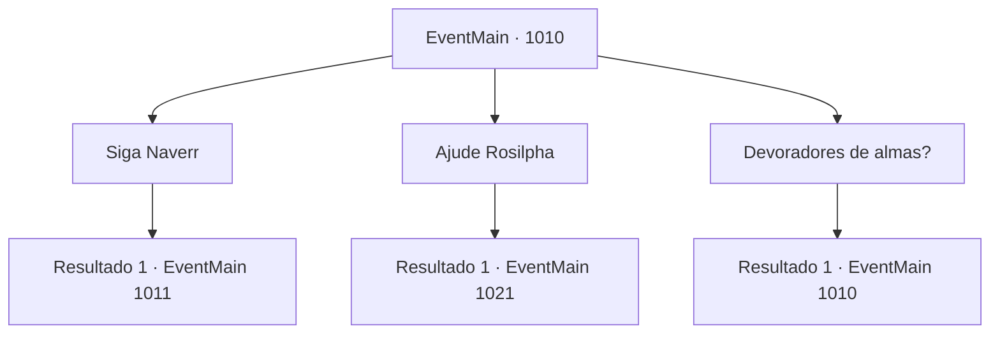

# Eventos principais · 1010

[Índice da tabela](index.md) · [Índice geral](../index.md)

ID: `pt:EventMain:1010` · Fonte: `EventMain4` · Versão: 1.2.47.

Mapeamento estático dos arquivos; a disponibilidade e a execução dependem do estado da run.

## Texto do evento

*Sem texto no arquivo.*

## Dados de entrada

```json
{
  "id": 1010,
  "grade": 1,
  "normalGoal": "",
  "required": ""
}
```

## Mapa das escolhas



## Escolhas e resultados

### Escolha 1

Siga Naverr

Requisitos e outros campos da escolha:

```json
{
  "required": "5_695_1"
}
```

#### Resultado 1.1

Você segue Naverr, enquanto Rosilpha decide ficar no solar. Naverr te leva até uma praia próxima. Lá, vocês encontram um grupo de devoradores de almas, flutuando na água. Eles parecem diferentes dos outros devoradores de almas que você viu antes. Três deles formam um triângulo no ar - e logo você percebe que um farol inteiro está sendo resgatado do mar por baixo. Naverr olha ao redor, gritando. 

 "Venham aqui! AQUI!"

 Há uma fragata, construída para combate, atracada nas proximidades. Naverr examina os canhões nela e murmura. 

 "Canhões...! Isso deve funcionar! Vamos lá!"

 Ele sobe apressadamente no navio, então se prepara para disparar os canhões. 

 "Traga munições! Devemos ser capazes de derrubá-los com isso!"


Continuação registrada: [Evento 1011](1011.md) na mesma tabela.

```json
{
  "required": "",
  "chance": "1",
  "nextEvent": 1011,
  "type": 2,
  "reward": ""
}
```

### Escolha 2

Ajude Rosilpha

Requisitos e outros campos da escolha:

```json
{
  "required": "5_695_1"
}
```

#### Resultado 2.1

Você decide ajudar Rosilpha. Naverr deixa a mansão sozinho, e Rosilpha vai falar com os moradores locais, dizendo para escaparem. Alguns moradores corajosos se juntam e decidem ajudar Rosilpha também. 

 Alguns momentos depois, a maioria dos moradores consegue sair da mansão em segurança. Logo, a mansão começa a desmoronar, revelando a verdadeira forma da água-viva gigante enquanto ela voa para os céus. Então, Naverr retorna da praia. Sua testa enrugada representa o quão ansioso ele está agora. 

 "Eles... eles pegaram o Disco da Lua."

 Naverr solta um longo suspiro. 

 "*suspiro*... Eles estão tentando abrir um portal para o Plano Astral. Este - este é nosso ÚLTIMO. CHANCE. Vamos para a Floresta de Andaria. Devemos tentar impedi-los, enquanto eles atravessam a fenda dimensional."

 Segundo ele, se você conseguir destruir o portal enquanto os monstros estão passando pela fenda dimensional, você pode prendê-los lá.

Continuação registrada: [Evento 1021](1021.md) na mesma tabela.

```json
{
  "required": "",
  "chance": "1",
  "nextEvent": 1021,
  "type": 2,
  "reward": "0_3_5"
}
```

### Escolha 3

Devoradores de almas?

Requisitos e outros campos da escolha:

```json
{
  "required": "5_695_0"
}
```

#### Resultado 3.1

Você pergunta a Naverr o que ele quer dizer com devoradores de almas. Ele responde colocando os dedos sob o queixo e movendo-os. 

 "Você viu um lá fora, não viu? Os monstros com tentáculos em seus queixos. Eles se alimentam de almas humanas. Por isso os chamamos de devoradores de almas."


Continuação registrada: [Evento 1010](1010.md) na mesma tabela.

```json
{
  "required": "",
  "chance": "1",
  "nextEvent": 1010,
  "type": 2,
  "reward": "5_695_1"
}
```

## Referências que chegam a este evento

- [Evento 1009 · escolha 2 · resultado 1](1009.md#escolha-2)
- [Evento 1009 · escolha 2 · resultado 2](1009.md#escolha-2)
- [Evento 1010 · escolha 3 · resultado 1](1010.md#escolha-3)
