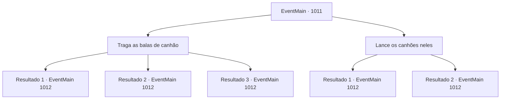

# Eventos principais · 1011

[Índice da tabela](index.md) · [Índice geral](../index.md)

ID: `pt:EventMain:1011` · Fonte: `EventMain4` · Versão: 1.2.47.

Mapeamento estático dos arquivos; a disponibilidade e a execução dependem do estado da run.

## Texto do evento

*Sem texto no arquivo.*

## Dados de entrada

```json
{
  "id": 1011,
  "grade": 1,
  "normalGoal": "",
  "required": ""
}
```

## Mapa das escolhas



## Escolhas e resultados

### Escolha 1

Traga as balas de canhão

Requisitos e outros campos da escolha:

```json
{
  "required": ""
}
```

#### Resultado 1.1

Você encontra os canhões e os entrega para Naverr. Ele acende os pavios, então mira cuidadosamente nos devoradores de almas. Segundos parecem minutos. 
 <link=shake>'BOOOO-OM!'</link> 
 A fumaça negra enche o ar quando o canhão é disparado. A pesada bala de canhão voa pelo ar, destruindo a cabeça de um dos devoradores de almas. Os dois sobreviventes te encaram e começam a voar em direção ao navio. Naverr os confronta com seu facão, se preparando para lutar.

Continuação registrada: [Evento 1012](1012.md) na mesma tabela.

```json
{
  "required": "21_0_2",
  "chance": "1",
  "nextEvent": 1012,
  "type": 0,
  "reward": "6_0_170",
  "place": 8
}
```

#### Resultado 1.2

Você encontra os canhões e os entrega para Naverr. Ele acende os pavios, então mira cuidadosamente nos devoradores de almas. Segundos parecem minutos. 
 <link=shake>'BOOOO-OM!'</link> 
 A fumaça negra enche o ar quando o canhão é disparado. Mas a bala de canhão erra, passando pelos devoradores de almas. Eles te encaram e começam a voar em direção ao navio. Naverr os enfrenta com seu facão, se preparando para lutar.

Continuação registrada: [Evento 1012](1012.md) na mesma tabela.

```json
{
  "required": "21_0_2",
  "chance": "1",
  "nextEvent": 1012,
  "type": 1,
  "reward": "6_3_170",
  "place": 8
}
```

#### Resultado 1.3

Você encontra os canhões e os entrega para Naverr. Ele acende os pavios, então mira cuidadosamente nos devoradores de almas. Segundos parecem minutos. 
 <link=shake>'BOOOO-OM!'</link> 
 A fumaça negra enche o ar quando o canhão é disparado. Você percebe que a bala de canhão está prestes a errar, então você altera magicamente sua direção. A pesada bala de canhão voa pelo ar, destruindo a cabeça de um dos devoradores de almas. Os dois sobreviventes te encaram e começam a voar em direção ao navio. Naverr os confronta com seu machado, se preparando para lutar.

Continuação registrada: [Evento 1012](1012.md) na mesma tabela.

```json
{
  "required": "20_0_2",
  "chance": "1",
  "nextEvent": 1012,
  "type": 2,
  "reward": "6_0_170",
  "place": 8
}
```

### Escolha 2

Lance os canhões neles

Requisitos e outros campos da escolha:

```json
{
  "required": ""
}
```

#### Resultado 2.1

Em vez de entregar para Naverr, você decide lançar a bala de canhão você mesmo. A pesada bala de canhão voa pelo ar com uma velocidade surpreendente, destruindo a cabeça de um dos devoradores de almas. Os dois sobreviventes te encaram e começam a voar em direção ao navio. Naverr os confronta com seu machado, se preparando para lutar.

Continuação registrada: [Evento 1012](1012.md) na mesma tabela.

```json
{
  "required": "",
  "chance": "1|0_5_1",
  "nextEvent": 1012,
  "type": 0,
  "reward": "6_0_170",
  "place": 8
}
```

#### Resultado 2.2

Em vez de entregar para Naverr, você decide lançar o canhão você mesmo. Mas o canhão não consegue alcançar os devoradores de almas, caindo no mar. Naverr parece perplexo e logo carrega o canhão e acende os pavios. Segundos parecem minutos. 
 <link=shake>'BOOOO-OM!'</link> 
 A fumaça negra enche o ar quando o canhão é disparado. Mas a bala de canhão erra, voando além dos devoradores de almas. Eles te encaram e começam a voar em direção ao navio. Naverr os enfrenta com seu facão, se preparando para lutar.

Continuação registrada: [Evento 1012](1012.md) na mesma tabela.

```json
{
  "required": "",
  "chance": "30",
  "nextEvent": 1012,
  "type": 1,
  "reward": "6_3_170",
  "place": 8
}
```

## Referências que chegam a este evento

- [Evento 1010 · escolha 1 · resultado 1](1010.md#escolha-1)
