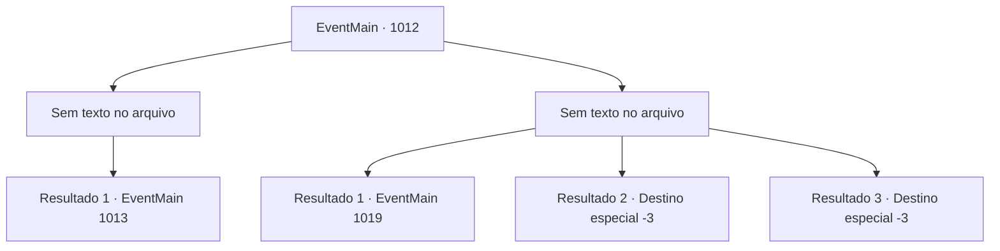

# Eventos principais · 1012

[Índice da tabela](index.md) · [Índice geral](../index.md)

ID: `pt:EventMain:1012` · Fonte: `EventMain4` · Versão: 1.2.47.

Mapeamento estático dos arquivos; a disponibilidade e a execução dependem do estado da run.

## Texto do evento

*Sem texto no arquivo.*

## Dados de entrada

```json
{
  "id": 1012,
  "grade": 1,
  "normalGoal": "",
  "required": ""
}
```

## Mapa das escolhas



## Escolhas e resultados

### Escolha 1

*Sem texto no arquivo; o papel dessa opção depende da interface do jogo.*

Requisitos e outros campos da escolha:

```json
{
  "required": ""
}
```

#### Resultado 1.1

Você e Naverr derrotam os devoradores de almas, pegando a Lente de Éter deles. Com esses monstros derrotados, o farol começa a afundar de volta para o oceano novamente. 

 "Vamos para a universidade. Eu conheço um lugar onde podemos guardar com segurança esse artefato."


Continuação registrada: [Evento 1013](1013.md) na mesma tabela.

```json
{
  "required": "",
  "chance": "1",
  "nextEvent": 1013,
  "type": 2,
  "reward": "3_315_1"
}
```

### Escolha 2

*Sem texto no arquivo; o papel dessa opção depende da interface do jogo.*

Requisitos e outros campos da escolha:

```json
{
  "required": ""
}
```

#### Resultado 2.1

Você é jogado no mar, atacado pelo relâmpago carmesim dos devoradores de almas. À medida que a água salgada invade sua boca e narinas, você começa a lutar na água. Naverr te resgata do mar. Os devoradores de almas se foram - Naverr estala a língua, olhando na direção em que partiram. 

 "Tsk.. Finalmente, eles colocam as mãos no Disco da Lua."

 Naverr acrescenta que eles devem estar indo para a Selva de Andaria, para abrir o portal para o Plano Astral. 

 "Precisamos encontrar o 'Olho Azul de Andaria'. Mas antes disso, precisamos verificar nosso amigo Rosilpha."

 Você segue Naverr de volta para a mansão. Então, o chão começa a tremer, enquanto a água-viva gigante da mansão sobe aos céus. A mansão então começa a desmoronar. 

 "AAAARRRRGHH--!"

 Os gritos de Rosilpha podem ser ouvidos. Você e Naverr se apressam em direção aos destroços da mansão.

Continuação registrada: [Evento 1019](1019.md) na mesma tabela.

```json
{
  "required": "1_0_2|1_1_2",
  "chance": "1",
  "nextEvent": 1019,
  "type": 2,
  "reward": "0_0_-1|0_1_-1"
}
```

#### Resultado 2.2

Você é derrubado pelo relâmpago carmesim dos devoradores de almas. O sangue jorra do seu pescoço, mas os monstros são impiedosos. Logo em seguida, outro raio o atinge, perfurando seu peito.

Continuação registrada: [Destino especial `-3`](../destinos-especiais.md).

```json
{
  "required": "2_0_2",
  "chance": "1",
  "nextEvent": -3,
  "type": 2,
  "reward": "0_0_-1|0_1_-1"
}
```

#### Resultado 2.3

Você é derrubado pelo relâmpago carmesim dos devoradores de almas. O sangue jorra do seu pescoço, mas os monstros são impiedosos. Logo em seguida, outro raio o atinge, perfurando seu peito.

Continuação registrada: [Destino especial `-3`](../destinos-especiais.md).

```json
{
  "required": "2_1_2",
  "chance": "1",
  "nextEvent": -3,
  "type": 2,
  "reward": "0_0_-1|0_1_-1"
}
```

## Referências que chegam a este evento

- [Evento 1011 · escolha 1 · resultado 1](1011.md#escolha-1)
- [Evento 1011 · escolha 1 · resultado 2](1011.md#escolha-1)
- [Evento 1011 · escolha 1 · resultado 3](1011.md#escolha-1)
- [Evento 1011 · escolha 2 · resultado 1](1011.md#escolha-2)
- [Evento 1011 · escolha 2 · resultado 2](1011.md#escolha-2)
