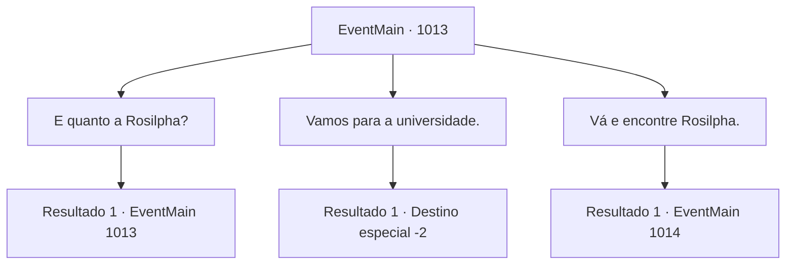

# Eventos principais · 1013

[Índice da tabela](index.md) · [Índice geral](../index.md)

ID: `pt:EventMain:1013` · Fonte: `EventMain4` · Versão: 1.2.47.

Mapeamento estático dos arquivos; a disponibilidade e a execução dependem do estado da run.

## Texto do evento

*Sem texto no arquivo.*

## Dados de entrada

```json
{
  "id": 1013,
  "grade": 1,
  "normalGoal": "",
  "required": ""
}
```

## Mapa das escolhas



## Escolhas e resultados

### Escolha 1

E quanto a Rosilpha?

Requisitos e outros campos da escolha:

```json
{
  "required": "5_696_0"
}
```

#### Resultado 1.1

Naverr balança a cabeça em resposta. 

 "Nós recuperamos a Lente de Éter, e agora matamos aqueles que estavam procurando pelo Disco da Lua. Os devoradores de almas devem estar reunindo todos os seus membros para nos encontrar. Não podemos voltar voluntariamente para a mansão. A universidade deve ser nosso próximo destino."


Continuação registrada: [Evento 1013](1013.md) na mesma tabela.

```json
{
  "required": "",
  "chance": "1",
  "nextEvent": 1013,
  "type": 2,
  "reward": "5_696_1"
}
```

### Escolha 2

Vamos para a universidade.

Requisitos e outros campos da escolha:

```json
{
  "required": "5_696_1"
}
```

#### Resultado 2.1

Você decide seguir Naverr. 

 "Nos vemos no campus, então. Acho que seria melhor se nos separássemos. Isso vai confundir os devoradores de almas."

 Você e Naverr concordam em seguir caminhos diferentes, indo em direções opostas. Você promete encontrá-lo na Universidade de Brikkalua.

Continuação registrada: [Destino especial `-2`](../destinos-especiais.md).

```json
{
  "required": "",
  "chance": "1",
  "nextEvent": -2,
  "type": 2,
  "reward": "13_5_63|15_6_18"
}
```

### Escolha 3

Vá e encontre Rosilpha.

Requisitos e outros campos da escolha:

```json
{
  "required": "5_696_1"
}
```

#### Resultado 3.1

Você insiste que os dois procurem por Rosilpha. Mas Naverr não está convencido. 

 "...Então eu vou pegar a Lente de Éter, para selá-la. Você vá procurar por Rosilpha."

 Naverr parte sozinho para Brikkalua, enquanto você se volta para a mansão, onde Rosilpha ficou para trás. Logo, você percebe um grupo de comedores de almas no caminho. Eles devem ter localizado Naverr, pois estão indo na mesma direção para onde ele foi.

Continuação registrada: [Evento 1014](1014.md) na mesma tabela.

```json
{
  "required": "",
  "chance": "1",
  "nextEvent": 1014,
  "type": 2,
  "reward": "4_315_1"
}
```

## Referências que chegam a este evento

- [Evento 1012 · escolha 1 · resultado 1](1012.md#escolha-1)
- [Evento 1013 · escolha 1 · resultado 1](1013.md#escolha-1)
