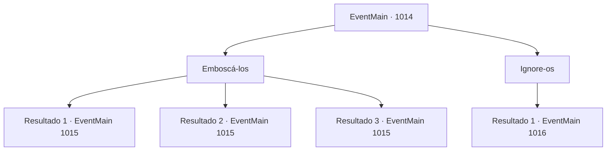

# Eventos principais · 1014

[Índice da tabela](index.md) · [Índice geral](../index.md)

ID: `pt:EventMain:1014` · Fonte: `EventMain4` · Versão: 1.2.47.

Mapeamento estático dos arquivos; a disponibilidade e a execução dependem do estado da run.

## Texto do evento

*Sem texto no arquivo.*

## Dados de entrada

```json
{
  "id": 1014,
  "grade": 1,
  "normalGoal": "",
  "required": ""
}
```

## Mapa das escolhas



## Escolhas e resultados

### Escolha 1

Emboscá-los

Requisitos e outros campos da escolha:

```json
{
  "required": ""
}
```

#### Resultado 1.1

Um dos devoradores de almas cai em sua emboscada. Isso bagunça suas formações. Você os ataca ferozmente, correndo em direção a eles.

Continuação registrada: [Evento 1015](1015.md) na mesma tabela.

```json
{
  "required": "21_5_4|21_43_1",
  "chance": "1|0_6_1",
  "nextEvent": 1015,
  "type": 0,
  "reward": "6_2_169",
  "place": 4
}
```

#### Resultado 1.2

Você tenta emboscá-los, mas eles imediatamente reconhecem sua presença e revidam.

Continuação registrada: [Evento 1015](1015.md) na mesma tabela.

```json
{
  "required": "21_5_4|21_43_1",
  "chance": "15",
  "nextEvent": 1015,
  "type": 1,
  "reward": "6_0_169",
  "place": 4
}
```

#### Resultado 1.3

Um dos devoradores de almas cai em sua emboscada. Isso bagunça suas formações. Você os ataca ferozmente, correndo em direção a eles.

Continuação registrada: [Evento 1015](1015.md) na mesma tabela.

```json
{
  "required": "-1|20_5_4|20_43_1",
  "chance": "1",
  "nextEvent": 1015,
  "type": 2,
  "reward": "6_2_169",
  "place": 4
}
```

### Escolha 2

Ignore-os

Requisitos e outros campos da escolha:

```json
{
  "required": ""
}
```

#### Resultado 2.1

Você ignora os devoradores de almas e segue direto para o casarão. Lá, você encontra Rosilpha, cercado por devoradores de almas volumosos. Ele te avista, então grita. 

 "A- AJUDA!"

 Você ataca imediatamente os devoradores de almas.

Continuação registrada: [Evento 1016](1016.md) na mesma tabela.

```json
{
  "required": "",
  "chance": "1",
  "nextEvent": 1016,
  "type": 2,
  "reward": "5_697_1|6_2_169",
  "place": 10
}
```

## Referências que chegam a este evento

- [Evento 1013 · escolha 3 · resultado 1](1013.md#escolha-3)
