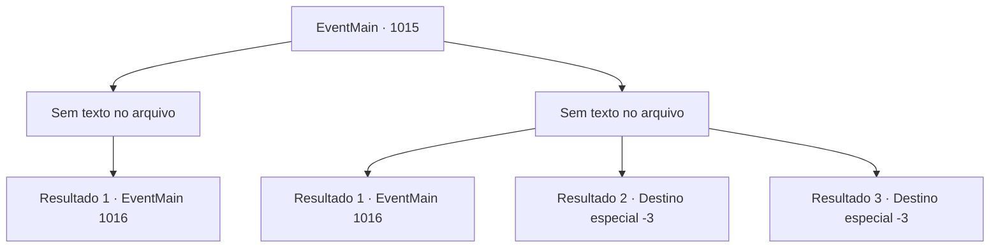

# Eventos principais · 1015

[Índice da tabela](index.md) · [Índice geral](../index.md)

ID: `pt:EventMain:1015` · Fonte: `EventMain4` · Versão: 1.2.47.

Mapeamento estático dos arquivos; a disponibilidade e a execução dependem do estado da run.

## Texto do evento

*Sem texto no arquivo.*

## Dados de entrada

```json
{
  "id": 1015,
  "grade": 1,
  "normalGoal": "",
  "required": ""
}
```

## Mapa das escolhas



## Escolhas e resultados

### Escolha 1

*Sem texto no arquivo; o papel dessa opção depende da interface do jogo.*

Requisitos e outros campos da escolha:

```json
{
  "required": ""
}
```

#### Resultado 1.1

Você derrota os devoradores de almas que estavam indo atrás de Naverr. Você então corre para o casarão, para encontrar Rosilpha. Logo, você chega ao casarão e encontra Rosilpha, cercado por devoradores de almas corpulentos. Ele te avista, e então grita. 

 "A- AJUDA!"

 Você imediatamente ataca os devoradores de almas.

Continuação registrada: [Evento 1016](1016.md) na mesma tabela.

```json
{
  "required": "",
  "chance": "1",
  "nextEvent": 1016,
  "type": 2,
  "reward": "6_2_169",
  "place": 10
}
```

### Escolha 2

*Sem texto no arquivo; o papel dessa opção depende da interface do jogo.*

Requisitos e outros campos da escolha:

```json
{
  "required": ""
}
```

#### Resultado 2.1

Os devoradores de almas batem impiedosamente em você com seus tentáculos, e você é forçado a fugir. Eles estão prestando pouca atenção em você, pois continuam na direção em que estavam indo antes. Enquanto foge em pânico, você se depara com Rosilpha. Ele também está lutando contra os devoradores de almas. Ele te avista e grita. 

 "A- AJUDA!"

 Você ataca imediatamente os devoradores de almas.

Continuação registrada: [Evento 1016](1016.md) na mesma tabela.

```json
{
  "required": "1_0_2|1_1_2",
  "chance": "1",
  "nextEvent": 1016,
  "type": 2,
  "reward": "0_0_-1|0_1_-1|5_697_1|6_2_169",
  "place": 10
}
```

#### Resultado 2.2

Os devoradores de almas atingem seu corpo, quebrando suas costelas. Uma dor indescritível abala sua consciência, enquanto o sangue jorra de seu pescoço. Um dos devoradores de almas se aproxima de você, então engole sua cabeça inteira com sua boca.

Continuação registrada: [Destino especial `-3`](../destinos-especiais.md).

```json
{
  "required": "2_0_2",
  "chance": "1",
  "nextEvent": -3,
  "type": 2,
  "reward": "0_0_-1|0_1_-1"
}
```

#### Resultado 2.3

Os devoradores de almas atingem seu corpo, quebrando suas costelas. Uma dor indescritível abala sua consciência, enquanto o sangue jorra de seu pescoço. Um dos devoradores de almas se aproxima de você, então engole sua cabeça inteira com sua boca.

Continuação registrada: [Destino especial `-3`](../destinos-especiais.md).

```json
{
  "required": "2_1_2",
  "chance": "1",
  "nextEvent": -3,
  "type": 2,
  "reward": "0_0_-1|0_1_-1"
}
```

## Referências que chegam a este evento

- [Evento 1014 · escolha 1 · resultado 1](1014.md#escolha-1)
- [Evento 1014 · escolha 1 · resultado 2](1014.md#escolha-1)
- [Evento 1014 · escolha 1 · resultado 3](1014.md#escolha-1)
