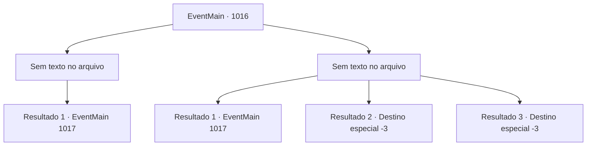

# Eventos principais · 1016

[Índice da tabela](index.md) · [Índice geral](../index.md)

ID: `pt:EventMain:1016` · Fonte: `EventMain4` · Versão: 1.2.47.

Mapeamento estático dos arquivos; a disponibilidade e a execução dependem do estado da run.

## Texto do evento

*Sem texto no arquivo.*

## Dados de entrada

```json
{
  "id": 1016,
  "grade": 1,
  "normalGoal": "",
  "required": ""
}
```

## Mapa das escolhas



## Escolhas e resultados

### Escolha 1

*Sem texto no arquivo; o papel dessa opção depende da interface do jogo.*

Requisitos e outros campos da escolha:

```json
{
  "required": ""
}
```

#### Resultado 1.1

Você derrota os devoradores de almas que estavam atacando Rosilpha. Então, o casarão começa a tremer, seu teto desabando. 

 "O lugar vai desmoronar! Precisamos sair!!"

 Rosilpha grita apressadamente.

Continuação registrada: [Evento 1017](1017.md) na mesma tabela.

```json
{
  "required": "",
  "chance": "1",
  "nextEvent": 1017,
  "type": 2,
  "reward": ""
}
```

### Escolha 2

*Sem texto no arquivo; o papel dessa opção depende da interface do jogo.*

Requisitos e outros campos da escolha:

```json
{
  "required": ""
}
```

#### Resultado 2.1

Você é jogado escada abaixo da mansão depois de receber o ataque dos devoradores de almas diretamente. Então, os devoradores de almas perdem subitamente o interesse em você e em Rosilpha, voltando para o navio deles. Os tentáculos da água-viva gigante começam a recolher os devoradores de almas, enquanto a mansão treme e seus tetos desabam. 

 "O lugar vai desmoronar! Precisamos sair!!"

 Rosilpha grita apressadamente.

Continuação registrada: [Evento 1017](1017.md) na mesma tabela.

```json
{
  "required": "1_0_2|1_1_2",
  "chance": "1",
  "nextEvent": 1017,
  "type": 2,
  "reward": "0_0_-1|0_1_-1"
}
```

#### Resultado 2.2

Você é jogado escada abaixo da mansão depois de receber o ataque dos devoradores de almas diretamente. Durante sua queda, você bate a cabeça em uma protuberância de ferro e perde a consciência. Rosilpha desce apressadamente as escadas para verificar você, mas é tarde demais.

Continuação registrada: [Destino especial `-3`](../destinos-especiais.md).

```json
{
  "required": "2_0_2",
  "chance": "1",
  "nextEvent": -3,
  "type": 2,
  "reward": "0_0_-1|0_1_-1"
}
```

#### Resultado 2.3

Você é jogado escada abaixo da mansão depois de receber o ataque dos devoradores de almas diretamente. Durante sua queda, você bate a cabeça em uma protuberância de ferro e perde a consciência. Rosilpha desce apressadamente as escadas para verificar você, mas é tarde demais.

Continuação registrada: [Destino especial `-3`](../destinos-especiais.md).

```json
{
  "required": "2_1_2",
  "chance": "1",
  "nextEvent": -3,
  "type": 2,
  "reward": "0_0_-1|0_1_-1"
}
```

## Referências que chegam a este evento

- [Evento 1014 · escolha 2 · resultado 1](1014.md#escolha-2)
- [Evento 1015 · escolha 1 · resultado 1](1015.md#escolha-1)
- [Evento 1015 · escolha 2 · resultado 1](1015.md#escolha-2)
