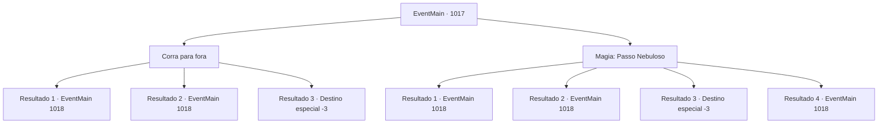

# Eventos principais · 1017

[Índice da tabela](index.md) · [Índice geral](../index.md)

ID: `pt:EventMain:1017` · Fonte: `EventMain4` · Versão: 1.2.47.

Mapeamento estático dos arquivos; a disponibilidade e a execução dependem do estado da run.

## Texto do evento

*Sem texto no arquivo.*

## Dados de entrada

```json
{
  "id": 1017,
  "grade": 1,
  "normalGoal": "",
  "required": ""
}
```

## Mapa das escolhas



## Escolhas e resultados

### Escolha 1

Corra para fora

Requisitos e outros campos da escolha:

```json
{
  "required": ""
}
```

#### Resultado 1.1

Você corre para fora, fugindo do teto desmoronante. Depois de chegar em segurança, Rosilpha solta um suspiro de alívio. No céu, a água-viva gigante está voando para algum lugar. Rosilpha olha para ela, então fala. 

 "Aquela coisa deve ter destruído a mansão em sua ascensão. Veja como é rápido... A propósito, o que aconteceu com Naverr?"


Continuação registrada: [Evento 1018](1018.md) na mesma tabela.

```json
{
  "required": "",
  "chance": "1|0_6_1",
  "nextEvent": 1018,
  "type": 0,
  "reward": ""
}
```

#### Resultado 1.2

Você corre para fora, fugindo do teto desmoronante. Mas você não é rápido o suficiente. Destroços e o lustre da mansão caem em cima de você. 

 "*gasp*...! {1}!"

 Rosilpha consegue te tirar dos destroços. Depois de puxar seu corpo para fora em segurança, Rosilpha solta um suspiro de alívio. No céu, a água-viva gigante está voando para algum lugar. Rosilpha olha para ela, então fala. 

 "Aquela coisa deve ter destruído a mansão em sua ascensão. Veja como é rápido... A propósito, o que aconteceu com Naverr?"


Continuação registrada: [Evento 1018](1018.md) na mesma tabela.

```json
{
  "required": "1_0_2",
  "chance": "15",
  "nextEvent": 1018,
  "type": 1,
  "reward": "0_0_-1"
}
```

#### Resultado 1.3

Você tenta sair da mansão, seguindo Rosilpha. No entanto, um lustre cai em cima de você. Ai de você, encontra o seu fim.

Continuação registrada: [Destino especial `-3`](../destinos-especiais.md).

```json
{
  "required": "2_0_2",
  "chance": "15",
  "nextEvent": -3,
  "type": 1,
  "reward": "0_0_-1"
}
```

### Escolha 2

Magia: Passo Nebuloso

Requisitos e outros campos da escolha:

```json
{
  "required": "20_0_1|1_1_2"
}
```

#### Resultado 2.1

Você se transforma magicamente em névoa, evitando os destroços que caem. Rosilpha escapa em segurança do casarão também, suspirando aliviado. No céu, a água-viva gigante está voando para algum lugar. Rosilpha olha para ela, e então fala. 

 "Aquela coisa deve ter destruído o casarão em sua ascensão. Veja como é rápido... A propósito, o que aconteceu com Naverr?"


Continuação registrada: [Evento 1018](1018.md) na mesma tabela.

```json
{
  "required": "21_0_4",
  "chance": "1|0_14_1",
  "nextEvent": 1018,
  "type": 0,
  "reward": "0_1_-1"
}
```

#### Resultado 2.2

Você tenta usar magia para evitar os destroços que caem, mas falha. Os destroços e o lustre da mansão caem em cima de você. 

 "*gasp*...! {1}!"

 Rosilpha consegue te tirar dos destroços. Depois de puxar seu corpo para um lugar seguro, Rosilpha solta um suspiro de alívio. No céu, a água-viva gigante está voando para algum lugar. Rosilpha olha para ela, e então fala. 

 "Aquela coisa deve ter destruído a mansão em sua ascensão. Veja como é rápido... A propósito, o que aconteceu com Naverr?"


Continuação registrada: [Evento 1018](1018.md) na mesma tabela.

```json
{
  "required": "21_0_4|1_0_2",
  "chance": "15",
  "nextEvent": 1018,
  "type": 1,
  "reward": "0_0_-1"
}
```

#### Resultado 2.3

Você tenta usar magia para evitar os destroços que caem, mas falha. Os destroços e o lustre da mansão caem em cima de você.

Continuação registrada: [Destino especial `-3`](../destinos-especiais.md).

```json
{
  "required": "21_0_4|2_0_2",
  "chance": "15",
  "nextEvent": -3,
  "type": 1,
  "reward": "0_0_-1"
}
```

#### Resultado 2.4

Você se transforma magicamente em névoa, evitando os destroços que caem. Rosilpha escapa em segurança do casarão também, suspirando aliviada. No céu, a água-viva gigante está voando para algum lugar. Rosilpha olha para ela, e então fala. 

 "Aquela coisa deve ter destruído o casarão em sua ascensão. Veja como é rápido... A propósito, o que aconteceu com Naverr?"


Continuação registrada: [Evento 1018](1018.md) na mesma tabela.

```json
{
  "required": "20_0_4",
  "chance": "1",
  "nextEvent": 1018,
  "type": 2,
  "reward": "0_1_-1"
}
```

## Referências que chegam a este evento

- [Evento 1016 · escolha 1 · resultado 1](1016.md#escolha-1)
- [Evento 1016 · escolha 2 · resultado 1](1016.md#escolha-2)
