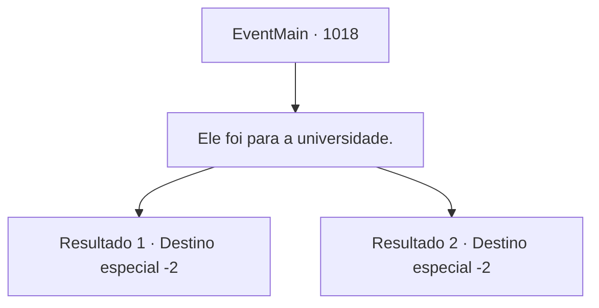

# Eventos principais · 1018

[Índice da tabela](index.md) · [Índice geral](../index.md)

ID: `pt:EventMain:1018` · Fonte: `EventMain4` · Versão: 1.2.47.

Mapeamento estático dos arquivos; a disponibilidade e a execução dependem do estado da run.

## Texto do evento

*Sem texto no arquivo.*

## Dados de entrada

```json
{
  "id": 1018,
  "grade": 1,
  "normalGoal": "",
  "required": ""
}
```

## Mapa das escolhas



## Escolhas e resultados

### Escolha 1

Ele foi para a universidade.

Requisitos e outros campos da escolha:

```json
{
  "required": ""
}
```

#### Resultado 1.1

Você responde que Naverr foi para a Universidade de Brikkalua. Rosilpha assente. 

 "Entendi. Nos vemos lá então."


Continuação registrada: [Destino especial `-2`](../destinos-especiais.md).

```json
{
  "required": "5_697_1",
  "chance": "1",
  "nextEvent": -2,
  "type": 2,
  "reward": "13_5_11"
}
```

#### Resultado 1.2

Você responde que Naverr foi para a Universidade de Brikkalua. Rosilpha assente. 

 "Entendi. Nos vemos lá então."


Continuação registrada: [Destino especial `-2`](../destinos-especiais.md).

```json
{
  "required": "18_697_1",
  "chance": "1",
  "nextEvent": -2,
  "type": 2,
  "reward": "13_5_102|5_704_1"
}
```

## Referências que chegam a este evento

- [Evento 1017 · escolha 1 · resultado 1](1017.md#escolha-1)
- [Evento 1017 · escolha 1 · resultado 2](1017.md#escolha-1)
- [Evento 1017 · escolha 2 · resultado 1](1017.md#escolha-2)
- [Evento 1017 · escolha 2 · resultado 2](1017.md#escolha-2)
- [Evento 1017 · escolha 2 · resultado 4](1017.md#escolha-2)
