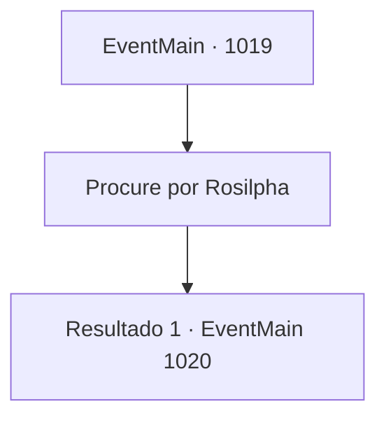

# Eventos principais · 1019

[Índice da tabela](index.md) · [Índice geral](../index.md)

ID: `pt:EventMain:1019` · Fonte: `EventMain4` · Versão: 1.2.47.

Mapeamento estático dos arquivos; a disponibilidade e a execução dependem do estado da run.

## Texto do evento

*Sem texto no arquivo.*

## Dados de entrada

```json
{
  "id": 1019,
  "grade": 1,
  "normalGoal": "",
  "required": ""
}
```

## Mapa das escolhas



## Escolhas e resultados

### Escolha 1

Procure por Rosilpha

Requisitos e outros campos da escolha:

```json
{
  "required": ""
}
```

#### Resultado 1.1

Você encontra Rosilpha preso sob os escombros da mansão. Seu pequeno corpo salvou sua vida. 

 "Ugh... Ack!"

 Você remove os escombros, tirando-o de lá. Você percebe que há uma barra de aço presa em suas pernas.

Continuação registrada: [Evento 1020](1020.md) na mesma tabela.

```json
{
  "required": "",
  "chance": "1",
  "nextEvent": 1020,
  "type": 2,
  "reward": ""
}
```

## Referências que chegam a este evento

- [Evento 1012 · escolha 2 · resultado 1](1012.md#escolha-2)
