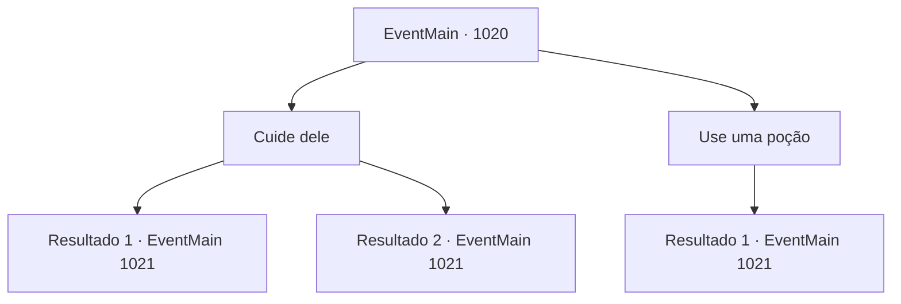

# Eventos principais · 1020

[Índice da tabela](index.md) · [Índice geral](../index.md)

ID: `pt:EventMain:1020` · Fonte: `EventMain4` · Versão: 1.2.47.

Mapeamento estático dos arquivos; a disponibilidade e a execução dependem do estado da run.

## Texto do evento

*Sem texto no arquivo.*

## Dados de entrada

```json
{
  "id": 1020,
  "grade": 1,
  "normalGoal": "",
  "required": ""
}
```

## Mapa das escolhas



## Escolhas e resultados

### Escolha 1

Cuide dele

Requisitos e outros campos da escolha:

```json
{
  "required": ""
}
```

#### Resultado 1.1

Você retira a haste de aço e enfaixa o ferimento. Graças ao seu tratamento, o sangramento de Rosilpha logo para. Ele enxuga o suor da testa. Sua expressão diz que sua operação foi bem-sucedida. 

 "Obrigado. Te devo uma."

 Então, Naverr abre a boca. 

 "Agora... Os monstros devem estar indo para 'o Olho Azul de Andaria'. Eles vão abrir o portal para o Plano Astral lá."

 Naverr afirma que é o último lugar onde você pode impedi-los.

Continuação registrada: [Evento 1021](1021.md) na mesma tabela.

```json
{
  "required": "",
  "chance": "1|0_7_1",
  "nextEvent": 1021,
  "type": 0,
  "reward": "0_3_2"
}
```

#### Resultado 1.2

Você tenta cuidar de Rosilpha. Mas sua inaptidão piora a ferida. O sangue jorra de suas pernas. 

 "Caramba! Eu farei isso. Sai da frente."

 Surpreso, Naverr te empurra para longe, cuidando ele mesmo das feridas de Rosilpha. Graças a ele, Rosilpha consegue sobreviver. Mas logo ele perde a consciência. 

 "Ele ainda está vivo. Mas perdeu muito sangue, então vai demorar um pouco para se recuperar. De qualquer forma..."

 Naverr respira fundo e continua. 

 "Agora... Os monstros devem estar indo para 'o Olho Azul de Andaria'. Eles vão abrir o portal para o Plano Astral lá."

 Naverr afirma que é o último lugar onde você pode impedi-los.

Continuação registrada: [Evento 1021](1021.md) na mesma tabela.

```json
{
  "required": "",
  "chance": "12",
  "nextEvent": 1021,
  "type": 1,
  "reward": ""
}
```

### Escolha 2

Use uma poção

Requisitos e outros campos da escolha:

```json
{
  "required": "23_6_1"
}
```

#### Resultado 2.1

Você retira a haste de aço e despeja uma poção na ferida. Graças ao seu tratamento, o sangramento de Rosilpha logo para. Ele enxuga o suor da testa. Sua expressão diz que sua operação foi bem-sucedida. 

 "Obrigado. Te devo uma."

 Então, Naverr abre a boca. 

 "Agora... Os monstros devem estar indo para 'o Olho Azul de Andaria'. Eles vão abrir o portal para o Plano Astral lá."

 Naverr afirma que é o último lugar onde você pode impedi-los.

Continuação registrada: [Evento 1021](1021.md) na mesma tabela.

```json
{
  "required": "",
  "chance": "1",
  "nextEvent": 1021,
  "type": 2,
  "reward": "25_6_1|0_3_5"
}
```

## Referências que chegam a este evento

- [Evento 1019 · escolha 1 · resultado 1](1019.md#escolha-1)
