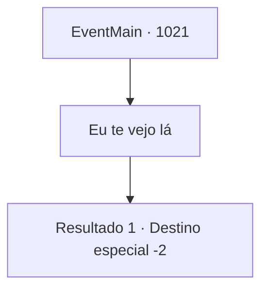

# Eventos principais · 1021

[Índice da tabela](index.md) · [Índice geral](../index.md)

ID: `pt:EventMain:1021` · Fonte: `EventMain4` · Versão: 1.2.47.

Mapeamento estático dos arquivos; a disponibilidade e a execução dependem do estado da run.

## Texto do evento

*Sem texto no arquivo.*

## Dados de entrada

```json
{
  "id": 1021,
  "grade": 1,
  "normalGoal": "",
  "required": ""
}
```

## Mapa das escolhas



## Escolhas e resultados

### Escolha 1

Eu te vejo lá

Requisitos e outros campos da escolha:

```json
{
  "required": ""
}
```

#### Resultado 1.1

Naverr assente em resposta. 

 "Devemos nos encontrar no Patinho Flutuante, na Selva de Andaria. Se apresse. Enquanto isso, terei uma reunião com o ancião grippli."

 Naverr leva Rosilpha e segue para a Selva de Andaria.

Continuação registrada: [Destino especial `-2`](../destinos-especiais.md).

```json
{
  "required": "",
  "chance": "1",
  "nextEvent": -2,
  "type": 2,
  "reward": "13_5_82"
}
```

## Referências que chegam a este evento

- [Evento 1010 · escolha 2 · resultado 1](1010.md#escolha-2)
- [Evento 1020 · escolha 1 · resultado 1](1020.md#escolha-1)
- [Evento 1020 · escolha 1 · resultado 2](1020.md#escolha-1)
- [Evento 1020 · escolha 2 · resultado 1](1020.md#escolha-2)
