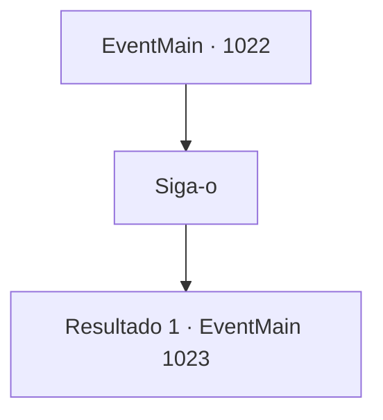

# Eventos principais · 1022

[Índice da tabela](index.md) · [Índice geral](../index.md)

ID: `pt:EventMain:1022` · Fonte: `EventMain4` · Versão: 1.2.47.

Mapeamento estático dos arquivos; a disponibilidade e a execução dependem do estado da run.

## Texto do evento

Você se dirige ao Patito Flotante. No meio da Jungla de Andaria, você encontra Rosilpha. Ele aperta ansiosamente seu arco. 

 "Então, vamos."


## Dados de entrada

```json
{
  "id": 1022,
  "grade": 1,
  "normalGoal": "",
  "required": "13_5_82|1_2_100"
}
```

## Mapa das escolhas



## Escolhas e resultados

### Escolha 1

Siga-o

Requisitos e outros campos da escolha:

```json
{
  "required": ""
}
```

#### Resultado 1.1

Você segue Rosilpha até sua aldeia, a Erva-de-Pato Flutuante. Ao chegar, você percebe que os gripplis já estão armados. Você também encontra uma enorme serpente feita de cipós de árvores, enrolada no lago. Entre eles, você encontra o grippli mais velho e Naverr. Naverr explica tudo o que aconteceu ao ancião, sobre os devoradores de almas levando o relicário e o plano para prendê-los na fenda dimensional. O grippli mais velho assente em resposta. 

 "Sim - a Serpente Divina previu a força distorcida que invadirá Andaria."


Continuação registrada: [Evento 1023](1023.md) na mesma tabela.

```json
{
  "required": "",
  "chance": "1",
  "nextEvent": 1023,
  "type": 2,
  "reward": ""
}
```

## Referências que chegam a este evento

Nenhum `nextEvent` positivo da mesma tabela aponta para este nó. Isso não prova que seja inacessível: sorteio e estado de história podem selecioná-lo.

