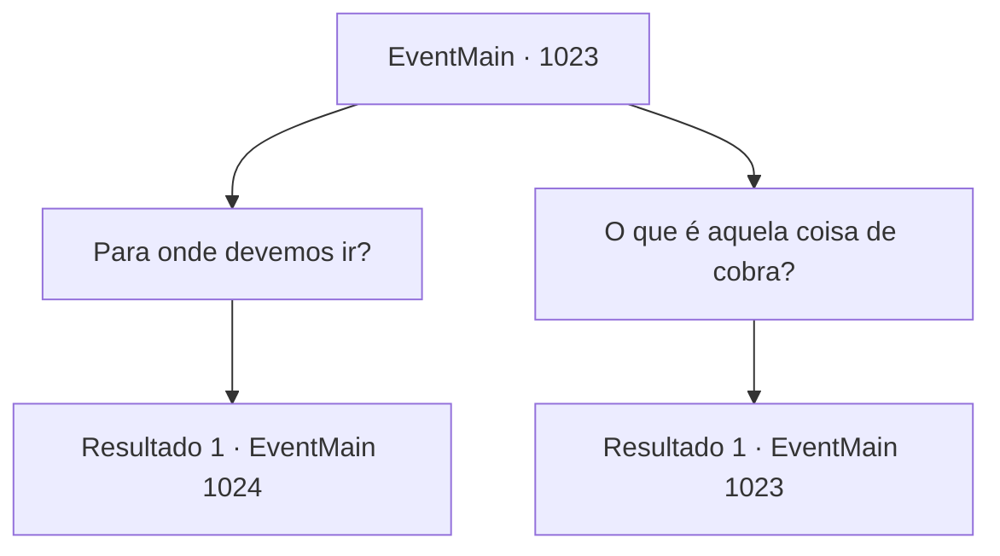

# Eventos principais · 1023

[Índice da tabela](index.md) · [Índice geral](../index.md)

ID: `pt:EventMain:1023` · Fonte: `EventMain4` · Versão: 1.2.47.

Mapeamento estático dos arquivos; a disponibilidade e a execução dependem do estado da run.

## Texto do evento

*Sem texto no arquivo.*

## Dados de entrada

```json
{
  "id": 1023,
  "grade": 1,
  "normalGoal": "",
  "required": ""
}
```

## Mapa das escolhas



## Escolhas e resultados

### Escolha 1

Para onde devemos ir?

Requisitos e outros campos da escolha:

```json
{
  "required": ""
}
```

#### Resultado 1.1

Naverr responde à sua pergunta. 

 "O Olho Azul de Andaria. Quando a lua carmesim se levanta, o portal para o Plano Astral pode ser aberto lá. Está ficando tarde - devemos nos apressar."


Continuação registrada: [Evento 1024](1024.md) na mesma tabela.

```json
{
  "required": "",
  "chance": "1",
  "nextEvent": 1024,
  "type": 2,
  "reward": ""
}
```

### Escolha 2

O que é aquela coisa de cobra?

Requisitos e outros campos da escolha:

```json
{
  "required": "5_698_0"
}
```

#### Resultado 2.1

Você aponta para a enorme serpente de videira da árvore e pergunta o que é aquilo. O ancião grippli limpa a garganta e responde. 

 "Ahem... Estrangeiros como você podem não saber, eu entendo. Aquilo é o avatar da Serpente Divina, imbuido com seus poderes."


Continuação registrada: [Evento 1023](1023.md) na mesma tabela.

```json
{
  "required": "",
  "chance": "1",
  "nextEvent": 1023,
  "type": 2,
  "reward": "5_698_1"
}
```

## Referências que chegam a este evento

- [Evento 1022 · escolha 1 · resultado 1](1022.md#escolha-1)
- [Evento 1023 · escolha 2 · resultado 1](1023.md#escolha-2)
