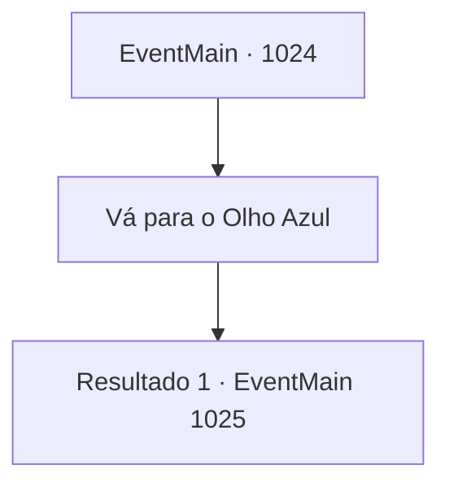

# Eventos principais · 1024

[Índice da tabela](index.md) · [Índice geral](../index.md)

ID: `pt:EventMain:1024` · Fonte: `EventMain4` · Versão: 1.2.47.

Mapeamento estático dos arquivos; a disponibilidade e a execução dependem do estado da run.

## Texto do evento

*Sem texto no arquivo.*

## Dados de entrada

```json
{
  "id": 1024,
  "grade": 1,
  "normalGoal": "",
  "required": ""
}
```

## Mapa das escolhas



## Escolhas e resultados

### Escolha 1

Vá para o Olho Azul

Requisitos e outros campos da escolha:

```json
{
  "required": ""
}
```

#### Resultado 1.1

Você navega pelas selvas com a serpente de videira de árvore, Rosilpha, e os guerreiros grippli. Finalmente, sua festa chega ao lago que é chamado de 'o Olho Azul de Andaria'. |drawing_astralPortal| A lua carmesim é refletida na superfície do lago. O portal para o Plano Astral está aberto, em cima dele. Não há ninguém por perto. Naverr resmunga consigo mesmo. 

 "Maldição... Eles devem ter ido para o Plano Astral já."


Continuação registrada: [Evento 1025](1025.md) na mesma tabela.

```json
{
  "required": "",
  "chance": "1",
  "nextEvent": 1025,
  "type": 2,
  "reward": ""
}
```

## Referências que chegam a este evento

- [Evento 1023 · escolha 1 · resultado 1](1023.md#escolha-1)
