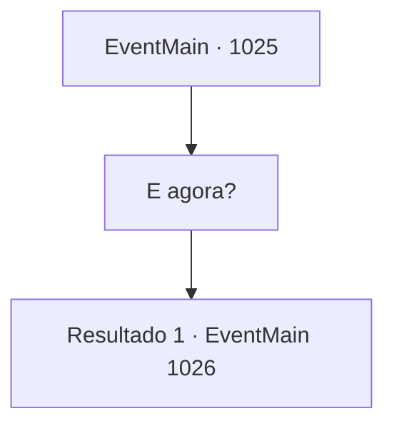

# Eventos principais · 1025

[Índice da tabela](index.md) · [Índice geral](../index.md)

ID: `pt:EventMain:1025` · Fonte: `EventMain4` · Versão: 1.2.47.

Mapeamento estático dos arquivos; a disponibilidade e a execução dependem do estado da run.

## Texto do evento

*Sem texto no arquivo.*

## Dados de entrada

```json
{
  "id": 1025,
  "grade": 1,
  "normalGoal": "",
  "required": ""
}
```

## Mapa das escolhas



## Escolhas e resultados

### Escolha 1

E agora?

Requisitos e outros campos da escolha:

```json
{
  "required": ""
}
```

#### Resultado 1.1

A serpente da videira da árvore responde à sua pergunta. 

 "Nós vamos atrás deles, é claro. Não podemos deixar essas coisas distorcidas devorarem almas. Vamos lá."

 Você e os gripplis pulam na serpente e, com um grito de batalha, entram no portal. Você passa pelo vazio do rift dimensional, sem nenhum sinal de, bem, qualquer coisa, antes de finalmente chegar ao Plano Astral. O lugar não se parece em nada com o Plano Material. Um espaço brilhante aparentemente interminável está cheio de uma fina névoa e luz das estrelas. Não há chão para pisar, mas de alguma forma você consegue flutuar no ar. 

 "Olhe, ali!"

 Quando você olha para onde Rosilpha apontou, encontra a enorme água-viva e os devoradores de almas que viu antes. Naverr também vê e então fala. 

 "Aquilo deve ser a nave de batalha deles. Precisamos entrar lá."


Continuação registrada: [Evento 1026](1026.md) na mesma tabela.

```json
{
  "required": "",
  "chance": "1",
  "nextEvent": 1026,
  "type": 2,
  "reward": ""
}
```

## Referências que chegam a este evento

- [Evento 1024 · escolha 1 · resultado 1](1024.md#escolha-1)
