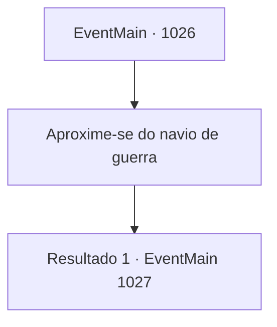

# Eventos principais · 1026

[Índice da tabela](index.md) · [Índice geral](../index.md)

ID: `pt:EventMain:1026` · Fonte: `EventMain4` · Versão: 1.2.47.

Mapeamento estático dos arquivos; a disponibilidade e a execução dependem do estado da run.

## Texto do evento

*Sem texto no arquivo.*

## Dados de entrada

```json
{
  "id": 1026,
  "grade": 1,
  "normalGoal": "",
  "required": ""
}
```

## Mapa das escolhas



## Escolhas e resultados

### Escolha 1

Aproxime-se do navio de guerra

Requisitos e outros campos da escolha:

```json
{
  "required": ""
}
```

#### Resultado 1.1

Você, Rosilpha e Naverr nadam através das névoas, se aproximando da água-viva gigante. Enquanto isso, os gripplis começam a batalha contra os devoradores de almas. Aqui e ali, gritos de guerra e sangue jorram. Então, cada um dos tentáculos do navio dos devoradores de almas se move por conta própria, emitindo feixes roxos de energia. Os guerreiros atingidos pelos feixes são lançados no vasto vazio. Então, um dos tentáculos começa a brilhar também. Ele mira em você e dispara um feixe roxo de energia.

Continuação registrada: [Evento 1027](1027.md) na mesma tabela.

```json
{
  "required": "",
  "chance": "1",
  "nextEvent": 1027,
  "type": 2,
  "reward": ""
}
```

## Referências que chegam a este evento

- [Evento 1025 · escolha 1 · resultado 1](1025.md#escolha-1)
