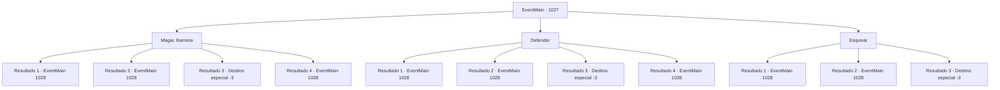

# Eventos principais · 1027

[Índice da tabela](index.md) · [Índice geral](../index.md)

ID: `pt:EventMain:1027` · Fonte: `EventMain4` · Versão: 1.2.47.

Mapeamento estático dos arquivos; a disponibilidade e a execução dependem do estado da run.

## Texto do evento

*Sem texto no arquivo.*

## Dados de entrada

```json
{
  "id": 1027,
  "grade": 1,
  "normalGoal": "",
  "required": ""
}
```

## Mapa das escolhas



## Escolhas e resultados

### Escolha 1

Magia: Barreira

Requisitos e outros campos da escolha:

```json
{
  "required": "1_1_2|20_0_2"
}
```

#### Resultado 1.1

Você bloqueia o feixe, conjurando uma barreira. Após a explosão, o tentáculo incha, emite fumaça e fica flácido. Seu grupo verifica entre os tentáculos uma abertura, finalmente encontrando uma entrada que leva para o interior. Naverr exclama. 

 "LÁ! Vamos entrar!"


Continuação registrada: [Evento 1028](1028.md) na mesma tabela.

```json
{
  "required": "21_0_4",
  "chance": "1|0_7_1|0_12_1",
  "nextEvent": 1028,
  "type": 0,
  "reward": "0_1_-1"
}
```

#### Resultado 1.2

Você conjura uma barreira, mas o feixe a despedaça em mil pedaços. Ainda assim, a barreira enfraqueceu o dano. Você sobrevive, com apenas ferimentos leves. Após a explosão, o tentáculo incha, emite fumaça e fica flácido. Seu grupo verifica entre os tentáculos por uma abertura, finalmente encontrando uma entrada que leva para o interior. Naverr exclama. 

 "LÁ! Vamos entrar!"


Continuação registrada: [Evento 1028](1028.md) na mesma tabela.

```json
{
  "required": "1_0_2|21_0_4",
  "chance": "40",
  "nextEvent": 1028,
  "type": 1,
  "reward": "0_0_-1|0_1_-1"
}
```

#### Resultado 1.3

Você conjura uma barreira, mas o feixe destrói a barreira em mil pedaços. Ainda assim, a barreira enfraqueceu o dano, mas ainda foi poderoso o suficiente para tirar sua vida. Com um grande buraco no peito, você cai na névoa do Plano Astral.

Continuação registrada: [Destino especial `-3`](../destinos-especiais.md).

```json
{
  "required": "2_0_2|21_0_4",
  "chance": "40",
  "nextEvent": -3,
  "type": 1,
  "reward": "0_0_-1|0_1_-1"
}
```

#### Resultado 1.4

Você bloqueia o feixe, conjurando uma barreira. Após a explosão, o tentáculo incha, emite fumaça e fica flácido. Seu grupo verifica entre os tentáculos uma abertura, finalmente encontrando uma entrada que leva para o interior. Naverr exclama. 

 "LÁ! Vamos entrar!"


Continuação registrada: [Evento 1028](1028.md) na mesma tabela.

```json
{
  "required": "20_0_4",
  "chance": "1",
  "nextEvent": 1028,
  "type": 2,
  "reward": "0_1_-1"
}
```

### Escolha 2

Defender

Requisitos e outros campos da escolha:

```json
{
  "required": "20_9_1"
}
```

#### Resultado 2.1

Você bloqueia o feixe. Após a explosão, o tentáculo incha, emite fumaça e fica flácido. Seu grupo verifica entre os tentáculos por uma abertura, finalmente encontrando uma entrada que leva para o interior. Naverr exclama. 

 "LÁ! Vamos entrar!"


Continuação registrada: [Evento 1028](1028.md) na mesma tabela.

```json
{
  "required": "21_9_4",
  "chance": "1|0_13_1",
  "nextEvent": 1028,
  "type": 0,
  "reward": ""
}
```

#### Resultado 2.2

Você tenta bloquear o feixe, mas falha. Ferido, você mal consegue se afastar da trajetória do feixe com a ajuda de Rosilpha. 

 "Está tudo bem?"

 Você balança a cabeça e diz que está bem por enquanto. Após a explosão, o tentáculo incha, emite fumaça e fica flácido. Seu grupo verifica entre os tentáculos em busca de uma abertura, finalmente encontrando uma entrada que leva ao interior. Naverr exclama. 

 "LÁ! Vamos entrar!"


Continuação registrada: [Evento 1028](1028.md) na mesma tabela.

```json
{
  "required": "21_9_4|1_0_2",
  "chance": "25",
  "nextEvent": 1028,
  "type": 1,
  "reward": "0_0_-1"
}
```

#### Resultado 2.3

Você não conseguiu bloquear o feixe. Com um grande buraco no peito, você cai na névoa do Plano Astral.

Continuação registrada: [Destino especial `-3`](../destinos-especiais.md).

```json
{
  "required": "21_9_4|2_0_2",
  "chance": "25",
  "nextEvent": -3,
  "type": 1,
  "reward": "0_0_-1"
}
```

#### Resultado 2.4

Você bloqueia o feixe. Após a explosão, o tentáculo incha, emite fumaça e fica flácido. Seu grupo verifica entre os tentáculos por uma abertura, finalmente encontrando uma entrada que leva para o interior. Naverr exclama. 

 "LÁ! Vamos entrar!"


Continuação registrada: [Evento 1028](1028.md) na mesma tabela.

```json
{
  "required": "20_9_4",
  "chance": "1",
  "nextEvent": 1028,
  "type": 2,
  "reward": ""
}
```

### Escolha 3

Esquivar

Requisitos e outros campos da escolha:

```json
{
  "required": ""
}
```

#### Resultado 3.1

Você rapidamente desvia do feixe. Ele passa por você, desaparecendo na névoa do Plano Astral. Após a explosão, o tentáculo incha, emite fumaça e fica flácido. Seu grupo verifica entre os tentáculos por uma abertura, finalmente encontrando uma entrada que leva para o interior. Naverr exclama. 

 "LÁ! Vamos entrar!"


Continuação registrada: [Evento 1028](1028.md) na mesma tabela.

```json
{
  "required": "",
  "chance": "1|0_6_1",
  "nextEvent": 1028,
  "type": 0,
  "reward": ""
}
```

#### Resultado 3.2

Você não consegue evitar o feixe. Ferido, você mal consegue se afastar da trajetória do feixe com a ajuda de Rosilpha. 

 "Está tudo bem?"

 Você balança a cabeça e diz que está bem por enquanto. Após a explosão, o tentáculo incha, emite fumaça e fica flácido. Seu grupo verifica entre os tentáculos uma abertura, finalmente encontrando uma entrada que leva para o interior. Naverr exclama. 

 "LÁ! Vamos entrar!"


Continuação registrada: [Evento 1028](1028.md) na mesma tabela.

```json
{
  "required": "1_0_2",
  "chance": "26",
  "nextEvent": 1028,
  "type": 1,
  "reward": "0_0_-1"
}
```

#### Resultado 3.3

Você falha em evitar a viga. Com um grande buraco no peito, você cai na névoa do Plano Astral.

Continuação registrada: [Destino especial `-3`](../destinos-especiais.md).

```json
{
  "required": "2_0_2",
  "chance": "26",
  "nextEvent": -3,
  "type": 1,
  "reward": "0_0_-1"
}
```

## Referências que chegam a este evento

- [Evento 1026 · escolha 1 · resultado 1](1026.md#escolha-1)
