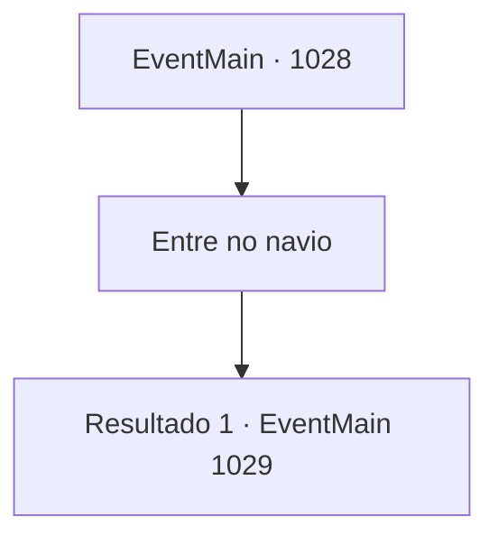

# Eventos principais · 1028

[Índice da tabela](index.md) · [Índice geral](../index.md)

ID: `pt:EventMain:1028` · Fonte: `EventMain4` · Versão: 1.2.47.

Mapeamento estático dos arquivos; a disponibilidade e a execução dependem do estado da run.

## Texto do evento

*Sem texto no arquivo.*

## Dados de entrada

```json
{
  "id": 1028,
  "grade": 1,
  "normalGoal": "",
  "required": ""
}
```

## Mapa das escolhas



## Escolhas e resultados

### Escolha 1

Entre no navio

Requisitos e outros campos da escolha:

```json
{
  "required": ""
}
```

#### Resultado 1.1

Os interiores do navio de guerra parecem órgãos de uma criatura, e estão entrelaçados como um labirinto intricado, tornando difícil a navegação. 

 "Eu vou liderar a partir daqui. Siga-me."

 Naverr lidera o caminho, dizendo que sabe onde a Rainha está. Você e Rosilpha seguem Naverr, indo para as partes mais profundas do navio de guerra. Depois de passar por um corredor estreito feito de células roxas vibrantes, um amplo espaço circular é revelado. Fascículos complicados estão conectados com esferas com símbolos que você nunca viu antes, e um devoralmas roxo está examinando-os.

Continuação registrada: [Evento 1029](1029.md) na mesma tabela.

```json
{
  "required": "",
  "chance": "1",
  "nextEvent": 1029,
  "type": 2,
  "reward": ""
}
```

## Referências que chegam a este evento

- [Evento 1027 · escolha 1 · resultado 1](1027.md#escolha-1)
- [Evento 1027 · escolha 1 · resultado 2](1027.md#escolha-1)
- [Evento 1027 · escolha 1 · resultado 4](1027.md#escolha-1)
- [Evento 1027 · escolha 2 · resultado 1](1027.md#escolha-2)
- [Evento 1027 · escolha 2 · resultado 2](1027.md#escolha-2)
- [Evento 1027 · escolha 2 · resultado 4](1027.md#escolha-2)
- [Evento 1027 · escolha 3 · resultado 1](1027.md#escolha-3)
- [Evento 1027 · escolha 3 · resultado 2](1027.md#escolha-3)
