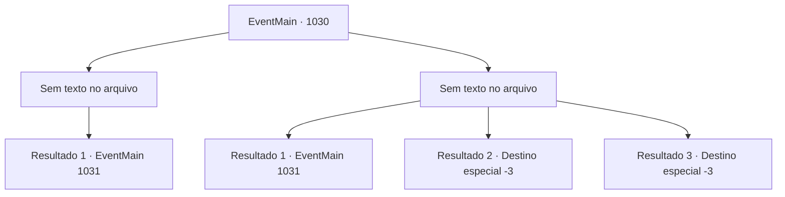

# Eventos principais · 1030

[Índice da tabela](index.md) · [Índice geral](../index.md)

ID: `pt:EventMain:1030` · Fonte: `EventMain4` · Versão: 1.2.47.

Mapeamento estático dos arquivos; a disponibilidade e a execução dependem do estado da run.

## Texto do evento

*Sem texto no arquivo.*

## Dados de entrada

```json
{
  "id": 1030,
  "grade": 1,
  "normalGoal": "",
  "required": ""
}
```

## Mapa das escolhas



## Escolhas e resultados

### Escolha 1

*Sem texto no arquivo; o papel dessa opção depende da interface do jogo.*

Requisitos e outros campos da escolha:

```json
{
  "required": ""
}
```

#### Resultado 1.1

Você mata o devoralmas. Ele desaba no chão e imediatamente o movimento da nave para. 

 "Este deve ter sido o piloto da nave. Agora, vamos."

 Você segue Naverr e segue para o lugar mais profundo do navio de guerra. Enquanto isso, parece que uma batalha feroz está acontecendo lá fora. O navio treme de choque, você ouve o som de rugidos e gritos misturados. Enquanto isso, Naverr permanece calmo. 

 "Aqui. Este é o lugar. A Rainha deve estar aqui, dentro desta sala."

 Onde ele aponta é uma porta redonda coberta com algum tipo de veias sanguíneas metálicas. Há uma joia avermelhada no meio da porta.

Continuação registrada: [Evento 1031](1031.md) na mesma tabela.

```json
{
  "required": "",
  "chance": "1",
  "nextEvent": 1031,
  "type": 2,
  "reward": ""
}
```

### Escolha 2

*Sem texto no arquivo; o papel dessa opção depende da interface do jogo.*

Requisitos e outros campos da escolha:

```json
{
  "required": ""
}
```

#### Resultado 2.1

Um raio vermelho disparado dos dedos do devoralmas atinge você diretamente. O impacto te joga para trás. Enquanto isso, Naverr corta o braço dele com seu facão, e então Rosilpha dispara uma flecha, mas erra. 

 "KKKEEEEEE!!"

 Gritando, o devoralmas dispara raios em Naverr, mas Naverr rola para longe do ataque. Enquanto os dois lidam com o devoralmas, você se levanta. Então, você golpeia com toda a sua força na parte de trás da cabeça dele. Com a colaboração dos três, o devoralmas finalmente desaba. Ele desaba no chão, e imediatamente o movimento do navio para. 

 "Este deve ter sido o piloto do navio. Agora, vamos."

 Você segue Naverr e entra no lugar mais profundo do navio de guerra. Enquanto isso, parece que uma batalha feroz está acontecendo lá fora. O navio treme em choque, você ouve o som de rugidos e gritos misturados. Enquanto isso, Naverr permanece calmo. 

 "Aqui. Este é o lugar. A Rainha deve estar aqui, dentro desta sala."

 Onde ele aponta é uma porta redonda coberta com algum tipo de veias sanguíneas metálicas. Há uma joia avermelhada no meio da porta.

Continuação registrada: [Evento 1031](1031.md) na mesma tabela.

```json
{
  "required": "1_0_2|1_1_2",
  "chance": "1",
  "nextEvent": 1031,
  "type": 2,
  "reward": "0_0_-1|0_1_-1"
}
```

#### Resultado 2.2

Um raio vermelho disparado dos dedos do devoralmas atinge você diretamente. O impacto te joga para trás e você perde a consciência.

Continuação registrada: [Destino especial `-3`](../destinos-especiais.md).

```json
{
  "required": "2_0_2",
  "chance": "1",
  "nextEvent": -3,
  "type": 2,
  "reward": "0_0_-1|0_1_-1"
}
```

#### Resultado 2.3

Um raio vermelho disparado dos dedos do devoralmas atinge você diretamente. O impacto te joga para trás e você perde a consciência.

Continuação registrada: [Destino especial `-3`](../destinos-especiais.md).

```json
{
  "required": "2_1_2",
  "chance": "1",
  "nextEvent": -3,
  "type": 2,
  "reward": "0_0_-1|0_1_-1"
}
```

## Referências que chegam a este evento

- [Evento 1029 · escolha 1 · resultado 2](1029.md#escolha-1)
- [Evento 1029 · escolha 2 · resultado 1](1029.md#escolha-2)
- [Evento 1029 · escolha 2 · resultado 2](1029.md#escolha-2)
- [Evento 1029 · escolha 2 · resultado 3](1029.md#escolha-2)
