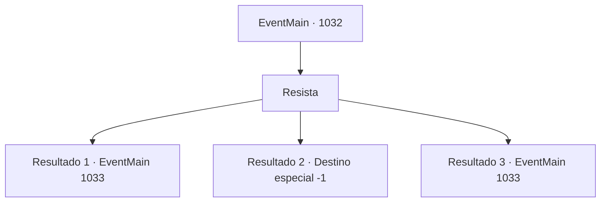

# Eventos principais · 1032

[Índice da tabela](index.md) · [Índice geral](../index.md)

ID: `pt:EventMain:1032` · Fonte: `EventMain4` · Versão: 1.2.47.

Mapeamento estático dos arquivos; a disponibilidade e a execução dependem do estado da run.

## Texto do evento

*Sem texto no arquivo.*

## Dados de entrada

```json
{
  "id": 1032,
  "grade": 1,
  "normalGoal": "",
  "required": ""
}
```

## Mapa das escolhas



## Escolhas e resultados

### Escolha 1

Resista

Requisitos e outros campos da escolha:

```json
{
  "required": ""
}
```

#### Resultado 1.1

Você consegue resistir à dominação da Rainha. Você olha ao redor, apenas para descobrir que os outros não são tão afortunados quanto você. A Rainha sorri, como se sua presença fosse interessante. 

 "Hmm? Um humano... que pode resistir à minha dominação? Estou intrigada. Não gostaria de se juntar a mim?"


Continuação registrada: [Evento 1033](1033.md) na mesma tabela.

```json
{
  "required": "24_7_1",
  "chance": "1|0_12_1",
  "nextEvent": 1033,
  "type": 0,
  "reward": ""
}
```

#### Resultado 1.2

Você nem consegue mexer um dedo. À medida que a Rainha se aproxima, Rosilpha e Naverr desmaiam. A Rainha faz um trabalho rápido em suas cabeças com seus tentáculos. Você é o próximo. 

 "Não tenha medo. Vou saborear cada pedacinho de sua alma mesquinha."

 Assim que termina de falar, sua boca se divide em cruzes, revelando os tentáculos brancos. Eles se enterram em seu nariz, boca e ouvidos em apenas um segundo. A súbita onda de dor o deixa impotente para resistir. Você perde a consciência e desmaia.

Continuação registrada: [Destino especial `-1`](../destinos-especiais.md).

```json
{
  "required": "24_7_1",
  "chance": "50",
  "nextEvent": -1,
  "type": 1,
  "reward": "25_8_1|15_6_0"
}
```

#### Resultado 1.3

Você consegue resistir à dominação da Rainha. Você olha ao redor, apenas para descobrir que os outros não são tão afortunados quanto você. A Rainha sorri, como se sua presença fosse interessante. 

 "Hmm? Um humano... que pode resistir à minha dominação? Estou intrigada. Não gostaria de se juntar a mim?"


Continuação registrada: [Evento 1033](1033.md) na mesma tabela.

```json
{
  "required": "23_7_1",
  "chance": "1",
  "nextEvent": 1033,
  "type": 2,
  "reward": ""
}
```

## Referências que chegam a este evento

- [Evento 1031 · escolha 1 · resultado 1](1031.md#escolha-1)
- [Evento 1031 · escolha 1 · resultado 2](1031.md#escolha-1)
- [Evento 1031 · escolha 1 · resultado 3](1031.md#escolha-1)
- [Evento 1031 · escolha 2 · resultado 1](1031.md#escolha-2)
- [Evento 1031 · escolha 3 · resultado 1](1031.md#escolha-3)
