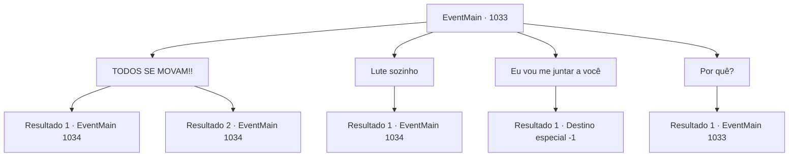

# Eventos principais · 1033

[Índice da tabela](index.md) · [Índice geral](../index.md)

ID: `pt:EventMain:1033` · Fonte: `EventMain4` · Versão: 1.2.47.

Mapeamento estático dos arquivos; a disponibilidade e a execução dependem do estado da run.

## Texto do evento

*Sem texto no arquivo.*

## Dados de entrada

```json
{
  "id": 1033,
  "grade": 1,
  "normalGoal": "",
  "required": ""
}
```

## Mapa das escolhas



## Escolhas e resultados

### Escolha 1

TODOS SE MOVAM!!

Requisitos e outros campos da escolha:

```json
{
  "required": ""
}
```

#### Resultado 1.1

Você grita com Rosilpha e Naverr. Assustados com sua voz, eles se libertam do domínio da Rainha. 

 "*ofegante*... *ofegante*...! Obrigado por isso! Pensei que meu coração ia parar."

 Rosilpha e Naverr ofegam, se preparando para lutar. A Rainha parece ainda mais intrigada. 

 "Muito interessante. Vão em frente, lutem mais."

 Então, ela dispara um raio de relâmpago carmesim de suas mãos.

Continuação registrada: [Evento 1034](1034.md) na mesma tabela.

```json
{
  "required": "",
  "chance": "1|0_12_1",
  "nextEvent": 1034,
  "type": 0,
  "reward": "6_0_171",
  "place": 15
}
```

#### Resultado 1.2

Você grita com Rosilpha e Naverr. Mas eles ainda estão congelados, como sapos diante de uma cobra. A Rainha tem pena de você. 

 "Você escolhe lutar até o fim. Você não me deixa escolha."

 Então, ela dispara um raio de relâmpago carmesim de suas mãos.

Continuação registrada: [Evento 1034](1034.md) na mesma tabela.

```json
{
  "required": "",
  "chance": "20",
  "nextEvent": 1034,
  "type": 1,
  "reward": "6_3_171",
  "place": 15
}
```

### Escolha 2

Lute sozinho

Requisitos e outros campos da escolha:

```json
{
  "required": ""
}
```

#### Resultado 2.1

Você decide confrontar a Rainha sozinho. Depois de ver você se preparar para lutar, a Rainha tem pena de você. 

 "Você escolhe lutar até o fim. Você não me deixa escolha."

 Então, ela dispara um raio de relâmpago carmesim de suas mãos.

Continuação registrada: [Evento 1034](1034.md) na mesma tabela.

```json
{
  "required": "",
  "chance": "1",
  "nextEvent": 1034,
  "type": 2,
  "reward": "6_3_171",
  "place": 15
}
```

### Escolha 3

Eu vou me juntar a você

Requisitos e outros campos da escolha:

```json
{
  "required": "5_700_1"
}
```

#### Resultado 3.1

Você escolhe se juntar à Rainha. Ela sorri gentilmente, segurando suas mãos. 

 "Fufu... Juntos, quebraremos esse ciclo. {1}."

 Assim que termina de falar, sua boca se divide em cruzes, revelando os tentáculos brancos. Eles se enterram em seu nariz, boca e ouvidos em apenas um segundo. O repentino influxo de dor o torna impotente para resistir. 

 "Aqui. Você agora é um de nós."

 Assim, você perde sua mente e se torna um devoralmas.

Continuação registrada: [Destino especial `-1`](../destinos-especiais.md).

```json
{
  "required": "",
  "chance": "1",
  "nextEvent": -1,
  "type": 2,
  "reward": "25_8_1|15_6_0|15_6_4"
}
```

### Escolha 4

Por quê?

Requisitos e outros campos da escolha:

```json
{
  "required": "5_700_0"
}
```

#### Resultado 4.1

Ela olha para você com seus olhos dourados e começa a falar com uma voz gentil e carinhosa. 

 "Eu sou a Rainha de Nepe-Akalish. Não temos intenção de lutar contra você. Pelo contrário - nós... estamos aqui para te salvar."

 Você pergunta o que isso significa. A Rainha responde com um leve sorriso. 

 "Seus Deuses criaram um sistema para explorá-los - o sistema que vocês humanos chamam de reencarnação. Presos em um ciclo interminável de nascimento e morte, vocês dedicam sua fé e almas a eles. E essas chamadas divindades sobrevivem com suas homenagens sem sentido."

 Ela continua com uma voz intensa. 

 "Pense nisso. Como os deuses são egoístas. Como são imprudentes. Sem vocês, eles não são nada - e ainda assim tratam vocês como se fossem gado! O que pretendemos fazer... é quebrar esse ciclo de exploração."

 Finalmente, Naverr resiste à Rainha e fala. 

 "M- MENTIRAS...!! Vocês são... nada mais... do que monstros que se alimentam de almas..!!"


Continuação registrada: [Evento 1033](1033.md) na mesma tabela.

```json
{
  "required": "",
  "chance": "1",
  "nextEvent": 1033,
  "type": 2,
  "reward": "5_700_1"
}
```

## Referências que chegam a este evento

- [Evento 1032 · escolha 1 · resultado 1](1032.md#escolha-1)
- [Evento 1032 · escolha 1 · resultado 3](1032.md#escolha-1)
- [Evento 1033 · escolha 4 · resultado 1](1033.md#escolha-4)
