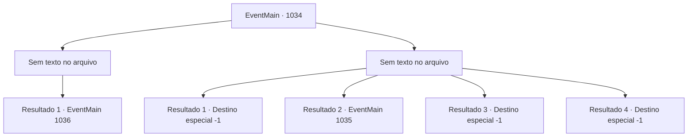

# Eventos principais · 1034

[Índice da tabela](index.md) · [Índice geral](../index.md)

ID: `pt:EventMain:1034` · Fonte: `EventMain4` · Versão: 1.2.47.

Mapeamento estático dos arquivos; a disponibilidade e a execução dependem do estado da run.

## Texto do evento

*Sem texto no arquivo.*

## Dados de entrada

```json
{
  "id": 1034,
  "grade": 1,
  "normalGoal": "",
  "required": ""
}
```

## Mapa das escolhas



## Escolhas e resultados

### Escolha 1

*Sem texto no arquivo; o papel dessa opção depende da interface do jogo.*

Requisitos e outros campos da escolha:

```json
{
  "required": ""
}
```

#### Resultado 1.1

A Rainha é derrubada pelo seu golpe final. Ela se agarra a você em seus estertores de morte. 

 "Eu... Eu não vou morrer assim..!"

 Então seu rosto se divide em cruzes, tentáculos brancos se esticam para fora dela. Mas você sacode a Rainha e esmaga sua cabeça no chão. Seu movimento para. Você deixa o navio devoralmas com Rosilpha e Naverr. A batalha lá fora também acabou. <link=shake>

 "*ribbit* *ribbit* *ribbit*!!"

</link> O som de sapos ecoa pelo lugar. Deve ser assim que os gripplis celebram a vitória.

Continuação registrada: [Evento 1036](1036.md) na mesma tabela.

```json
{
  "required": "",
  "chance": "1",
  "nextEvent": 1036,
  "type": 2,
  "reward": ""
}
```

### Escolha 2

*Sem texto no arquivo; o papel dessa opção depende da interface do jogo.*

Requisitos e outros campos da escolha:

```json
{
  "required": ""
}
```

#### Resultado 2.1

Você é jogado no chão pelos ataques da Rainha. A Rainha agarra você com seus tentáculos. Então, sua boca se divide em cruzes, revelando os tentáculos brancos. Eles se enterram em seu nariz, boca e ouvidos em apenas um segundo. O repentino influxo de dor o torna impotente para resistir. 

 "Agora você é um de nós."

 Assim, você perde sua mente e se torna um devoralmas.

Continuação registrada: [Destino especial `-1`](../destinos-especiais.md).

```json
{
  "required": "5_677_1",
  "chance": "1",
  "nextEvent": -1,
  "type": 2,
  "reward": "0_0_-1|0_1_-1|25_8_1|15_6_0|15_6_4"
}
```

#### Resultado 2.2

Você é jogado ao chão pelos ataques da Rainha. A Rainha agarra você com seus tentáculos. Então, sua boca se divide em cruzes, revelando os tentáculos brancos. Em seguida, um impacto poderoso destroça as paredes da sala, enquanto a serpente gigante de videira aparece. A Rainha a enfrenta furiosamente. 

 "EU NÃO SEREI PERTURBADA!!"

 Graças a essa intervenção, você tem uma segunda chance. Rosilpha e Naverr te ajudam a se levantar, e os três se preparam para lutar contra a Rainha mais uma vez.

Continuação registrada: [Evento 1035](1035.md) na mesma tabela.

```json
{
  "required": "1_0_2|1_1_2|18_677_1",
  "chance": "1",
  "nextEvent": 1035,
  "type": 2,
  "reward": "6_2_171|0_0_-1|0_1_-1",
  "place": 15
}
```

#### Resultado 2.3

Você não é páreo para a Rainha dos devoradores de almas. Um raio de relâmpago carmesim disparado pela Rainha deixa um buraco gigante em seu peito. Você cai de joelhos, vomitando uma grande quantidade de sangue. Então, finalmente você perde a consciência.

Continuação registrada: [Destino especial `-1`](../destinos-especiais.md).

```json
{
  "required": "2_0_2|18_677_1",
  "chance": "1",
  "nextEvent": -1,
  "type": 2,
  "reward": "0_0_-1|0_1_-1|25_8_1|15_6_0"
}
```

#### Resultado 2.4

Você não é páreo para a Rainha dos devoradores de almas. Um raio de relâmpago carmesim disparado pela Rainha deixa um buraco gigante em seu peito. Você cai de joelhos, vomitando uma grande quantidade de sangue. Então, finalmente você perde a consciência.

Continuação registrada: [Destino especial `-1`](../destinos-especiais.md).

```json
{
  "required": "2_1_2|18_677_1",
  "chance": "1",
  "nextEvent": -1,
  "type": 2,
  "reward": "0_0_-1|0_1_-1|25_8_1|15_6_0"
}
```

## Referências que chegam a este evento

- [Evento 1033 · escolha 1 · resultado 1](1033.md#escolha-1)
- [Evento 1033 · escolha 1 · resultado 2](1033.md#escolha-1)
- [Evento 1033 · escolha 2 · resultado 1](1033.md#escolha-2)
