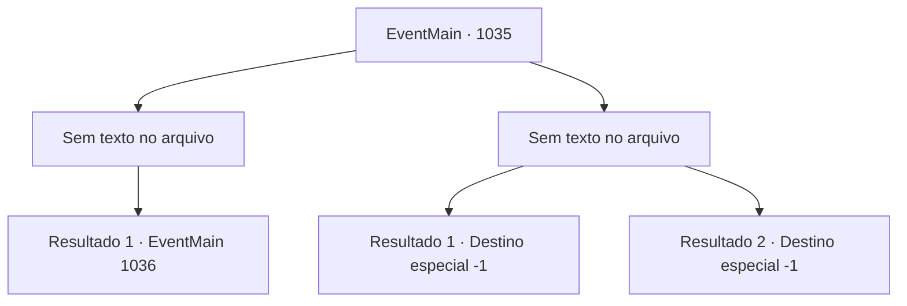

# Eventos principais · 1035

[Índice da tabela](index.md) · [Índice geral](../index.md)

ID: `pt:EventMain:1035` · Fonte: `EventMain4` · Versão: 1.2.47.

Mapeamento estático dos arquivos; a disponibilidade e a execução dependem do estado da run.

## Texto do evento

*Sem texto no arquivo.*

## Dados de entrada

```json
{
  "id": 1035,
  "grade": 1,
  "normalGoal": "",
  "required": ""
}
```

## Mapa das escolhas



## Escolhas e resultados

### Escolha 1

*Sem texto no arquivo; o papel dessa opção depende da interface do jogo.*

Requisitos e outros campos da escolha:

```json
{
  "required": ""
}
```

#### Resultado 1.1

A Rainha é derrubada pelo seu golpe final. Ela se agarra a você em seus estertores de morte. 

 "Eu... Eu não vou morrer assim..!"

 Então seu rosto se divide em cruzes, tentáculos brancos se esticam para fora dela. Mas você sacode a Rainha e esmaga sua cabeça no chão. Seu movimento para. Você deixa o navio devoralmas com Rosilpha e Naverr. A batalha lá fora também acabou. <link=shake>

 "*croak * *croak * *croak *!!"

</link> O som de sapos ecoa pelo lugar. Deve ser assim que os gripplis celebram a vitória.

Continuação registrada: [Evento 1036](1036.md) na mesma tabela.

```json
{
  "required": "",
  "chance": "1",
  "nextEvent": 1036,
  "type": 2,
  "reward": ""
}
```

### Escolha 2

*Sem texto no arquivo; o papel dessa opção depende da interface do jogo.*

Requisitos e outros campos da escolha:

```json
{
  "required": ""
}
```

#### Resultado 2.1

Mesmo um avatar da Serpente Divina não é páreo para a Rainha dos devoradores de almas. A serpente de videira da árvore se despedaça em pedaços, e a furiosa Rainha reduz você, Naverr e Rosilpha a cinzas com seu relâmpago carmesim.

Continuação registrada: [Destino especial `-1`](../destinos-especiais.md).

```json
{
  "required": "",
  "chance": "1",
  "nextEvent": -1,
  "type": 2,
  "reward": "0_0_-1|0_1_-1|25_8_1|15_6_0"
}
```

#### Resultado 2.2

Mesmo um avatar da Serpente Divina não é páreo para a Rainha dos devoradores de almas. A serpente de videira da árvore se despedaça em pedaços, e a furiosa Rainha reduz você, Naverr e Rosilpha a cinzas com seu relâmpago carmesim.

Continuação registrada: [Destino especial `-1`](../destinos-especiais.md).

```json
{
  "required": "",
  "chance": "1",
  "nextEvent": -1,
  "type": 2,
  "reward": "0_0_-1|0_1_-1|25_8_1|15_6_0"
}
```

## Referências que chegam a este evento

- [Evento 1034 · escolha 2 · resultado 2](1034.md#escolha-2)
