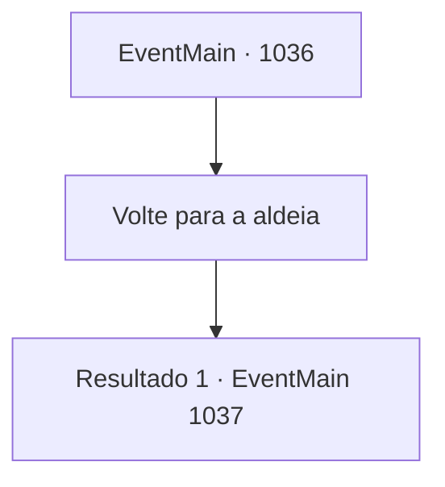

# Eventos principais · 1036

[Índice da tabela](index.md) · [Índice geral](../index.md)

ID: `pt:EventMain:1036` · Fonte: `EventMain4` · Versão: 1.2.47.

Mapeamento estático dos arquivos; a disponibilidade e a execução dependem do estado da run.

## Texto do evento

*Sem texto no arquivo.*

## Dados de entrada

```json
{
  "id": 1036,
  "grade": 1,
  "normalGoal": "",
  "required": ""
}
```

## Mapa das escolhas



## Escolhas e resultados

### Escolha 1

Volte para a aldeia

Requisitos e outros campos da escolha:

```json
{
  "required": ""
}
```

#### Resultado 1.1

Sua festa nada pelo Plano Astral, de volta através da fenda dimensional, e retorna para a Selva de Andaria. No Patinho Flutuante, os gripplis sobreviventes estão celebrando sua vitória. Eles te apresentam seus pratos locais, como lagartas cozidas, erva de pato frita e vinho de musgo fermentado. Naverr agradece a eles e começa a provar a culinária feliz. Você está pensando se deve experimentá-los ou não, enquanto Rosilpha começa a devorar as lagartas com fome. 

 "O que houve? Não está com fome? Bem, é completamente compreensível - a fadiga faz isso com você."

 Então, a serpente de videira da árvore aparece novamente. 

 "Ambos desempenharam um papel enorme na proteção da selva. Diga, tenho uma oferta a fazer. Você estaria disposto a se tornar um campeão de Andaria?"

 Ao ouvir isso, Rosilpha pula de excitação. 

 "S- sério?!"

  Algumas partes das lagartas caem de sua boca. Então o ancião cutuca suas costelas com o cotovelo. Quando o ancião lhe dá uma dica, Rosilpha suprime sua alegria e se ajoelha em sua perna. 

 "Caso você me conceda tal posição, farei o meu melhor para cumprir meu dever."

 Naverr olha para você cuidadosamente e fala. 

 "...Tenho uma posição para voltar, de volta à universidade. {1}, afinal, é sua decisão, mas eu pessoalmente preferiria que você permanecesse um estudioso também."


Continuação registrada: [Evento 1037](1037.md) na mesma tabela.

```json
{
  "required": "",
  "chance": "1",
  "nextEvent": 1037,
  "type": 2,
  "reward": ""
}
```

## Referências que chegam a este evento

- [Evento 1034 · escolha 1 · resultado 1](1034.md#escolha-1)
- [Evento 1035 · escolha 1 · resultado 1](1035.md#escolha-1)
