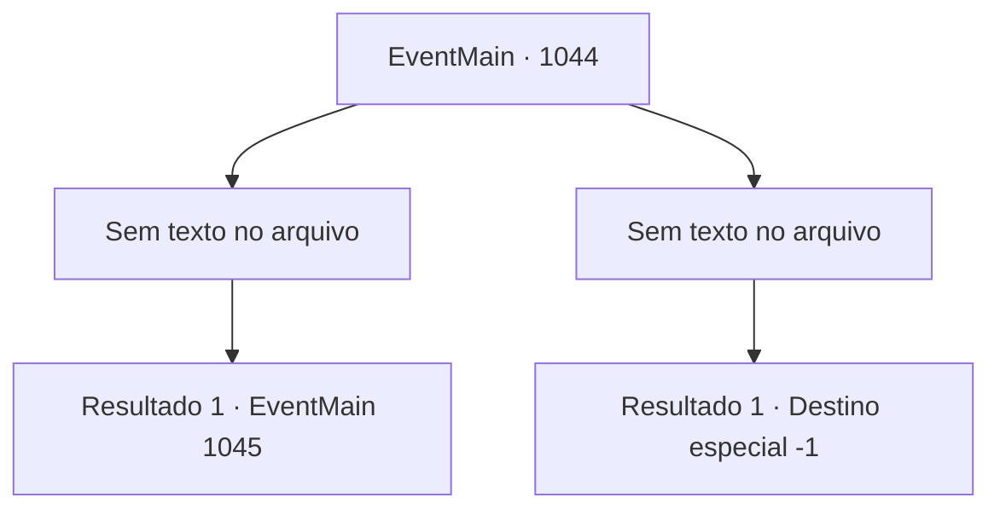

# Eventos principais · 1044

[Índice da tabela](index.md) · [Índice geral](../index.md)

ID: `pt:EventMain:1044` · Fonte: `EventMain4` · Versão: 1.2.47.

Mapeamento estático dos arquivos; a disponibilidade e a execução dependem do estado da run.

## Texto do evento

*Sem texto no arquivo.*

## Dados de entrada

```json
{
  "id": 1044,
  "grade": 1,
  "normalGoal": "",
  "required": ""
}
```

## Mapa das escolhas



## Escolhas e resultados

### Escolha 1

*Sem texto no arquivo; o papel dessa opção depende da interface do jogo.*

Requisitos e outros campos da escolha:

```json
{
  "required": ""
}
```

#### Resultado 1.1

Você luta bravamente. O número deles é suficiente para sobrecarregar vocês dois, mas a maré da batalha já está a seu favor. A Rainha decide lidar com as coisas pessoalmente, sinalizando para os outros devoradores de almas recuarem. Ela passa por cima de seus subordinados caídos e fala friamente. 

 "Vejo que você não é tão fraco quanto os outros. Eu vou acabar com você com minhas próprias mãos."|drawing_outerQueenTrue| As costas da Rainha se abrem, revelando sua verdadeira forma. Há um emaranhado de tentáculos de cor cinza claro que se parecem com um cérebro enorme. Em sua superfície, algo brilhante está se movendo ao longo das veias sanguíneas, e abaixo disso, há inúmeros tentáculos com espinhos. A forma de uma bela dama está pendurada na parte inferior do enorme monte, como uma pituitária. A Rainha começa a atacar, agitando seus tentáculos em sua direção.

Continuação registrada: [Evento 1045](1045.md) na mesma tabela.

```json
{
  "required": "",
  "chance": "1",
  "nextEvent": 1045,
  "type": 2,
  "reward": "6_0_171",
  "place": 10
}
```

### Escolha 2

*Sem texto no arquivo; o papel dessa opção depende da interface do jogo.*

Requisitos e outros campos da escolha:

```json
{
  "required": ""
}
```

#### Resultado 2.1

Você luta bravamente. No entanto, os devoradores de almas continuam vindo e vindo, e eventualmente você fica sem forças. A Rainha nem olha para você enquanto ordena que seus subordinados o executem. Ai, tentáculos devoradores de almas perfuram seu crânio.

Continuação registrada: [Destino especial `-1`](../destinos-especiais.md).

```json
{
  "required": "",
  "chance": "1",
  "nextEvent": -1,
  "type": 2,
  "reward": "15_6_15|15_6_25|25_8_1"
}
```

## Referências que chegam a este evento

- [Evento 1043 · escolha 1 · resultado 1](1043.md#escolha-1)
