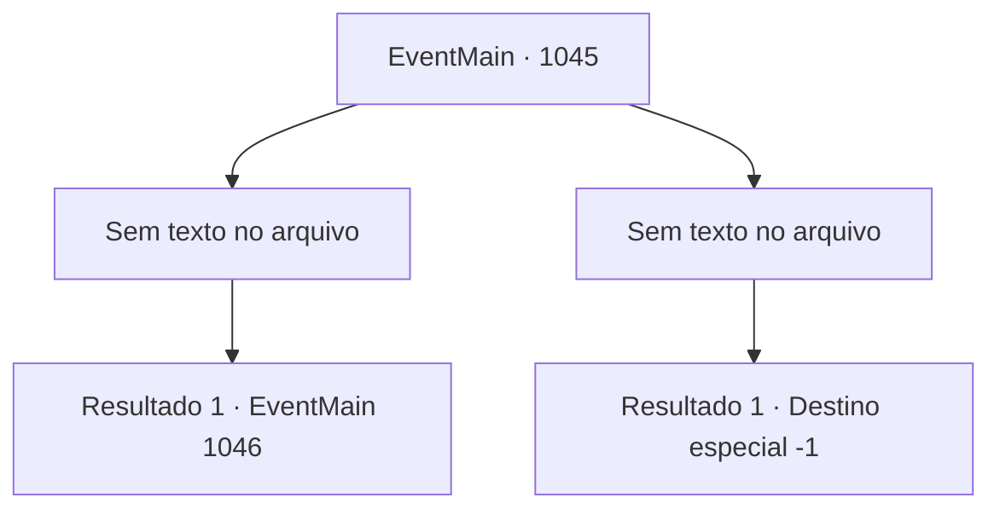

# Eventos principais · 1045

[Índice da tabela](index.md) · [Índice geral](../index.md)

ID: `pt:EventMain:1045` · Fonte: `EventMain4` · Versão: 1.2.47.

Mapeamento estático dos arquivos; a disponibilidade e a execução dependem do estado da run.

## Texto do evento

*Sem texto no arquivo.*

## Dados de entrada

```json
{
  "id": 1045,
  "grade": 1,
  "normalGoal": "",
  "required": ""
}
```

## Mapa das escolhas



## Escolhas e resultados

### Escolha 1

*Sem texto no arquivo; o papel dessa opção depende da interface do jogo.*

Requisitos e outros campos da escolha:

```json
{
  "required": ""
}
```

#### Resultado 1.1

Seu golpe poderoso faz a Rainha cambalear. Você aproveita a oportunidade e tenta finalizá-la, mas não alcança a Rainha. Um dos devoradores de almas se sacrifica para levar o golpe no lugar. Segurando a ferida, a Rainha exclama com fúria. 

 "Ah...! Isso... não é o fim...!!"

 Um longo tentáculo desce da nave de batalha. A Rainha e os devoradores de almas voam de volta para a nave, seguindo o tentáculo, e desaparecem nas nuvens. Logo, Naverr e o Diretor voltam. Você conta a eles que derrotou os devoradores de almas, e após ouvir o que aconteceu, Naverr questiona de volta, perplexo. 

 "...A Rainha e os devoradores de almas fugiram? I- Isso é verdade?!"


Continuação registrada: [Evento 1046](1046.md) na mesma tabela.

```json
{
  "required": "",
  "chance": "1",
  "nextEvent": 1046,
  "type": 2,
  "reward": ""
}
```

### Escolha 2

*Sem texto no arquivo; o papel dessa opção depende da interface do jogo.*

Requisitos e outros campos da escolha:

```json
{
  "required": ""
}
```

#### Resultado 2.1

Os tentáculos da Rainha se lançam em sua direção. Você falha em impedi-los de perfurar sua cabeça. Ai de você, você vomita sangue e desaba no chão.

Continuação registrada: [Destino especial `-1`](../destinos-especiais.md).

```json
{
  "required": "",
  "chance": "1",
  "nextEvent": -1,
  "type": 2,
  "reward": "15_6_15|15_6_25|25_8_1"
}
```

## Referências que chegam a este evento

- [Evento 1044 · escolha 1 · resultado 1](1044.md#escolha-1)
