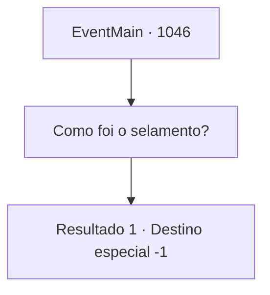

# Eventos principais · 1046

[Índice da tabela](index.md) · [Índice geral](../index.md)

ID: `pt:EventMain:1046` · Fonte: `EventMain4` · Versão: 1.2.47.

Mapeamento estático dos arquivos; a disponibilidade e a execução dependem do estado da run.

## Texto do evento

*Sem texto no arquivo.*

## Dados de entrada

```json
{
  "id": 1046,
  "grade": 1,
  "normalGoal": "",
  "required": ""
}
```

## Mapa das escolhas



## Escolhas e resultados

### Escolha 1

Como foi o selamento?

Requisitos e outros campos da escolha:

```json
{
  "required": ""
}
```

#### Resultado 1.1

Você assente, perguntando o que aconteceu com o artefato. Naverr solta um suspiro de alívio e sorri. 

 "Nós acabamos de selá-lo. Não precisaremos mais nos preocupar com os devoradores de almas voltando. Bom trabalho, todos. Especialmente você, {1}. Isso teria sido impossível sem você."

 Você dá de ombros, olhando para o céu da noite. É hora de terminar sua aventura e voltar para uma vida comum.

Continuação registrada: [Destino especial `-1`](../destinos-especiais.md).

```json
{
  "required": "",
  "chance": "1",
  "nextEvent": -1,
  "type": 2,
  "reward": "15_6_20|15_6_16"
}
```

## Referências que chegam a este evento

- [Evento 1045 · escolha 1 · resultado 1](1045.md#escolha-1)
