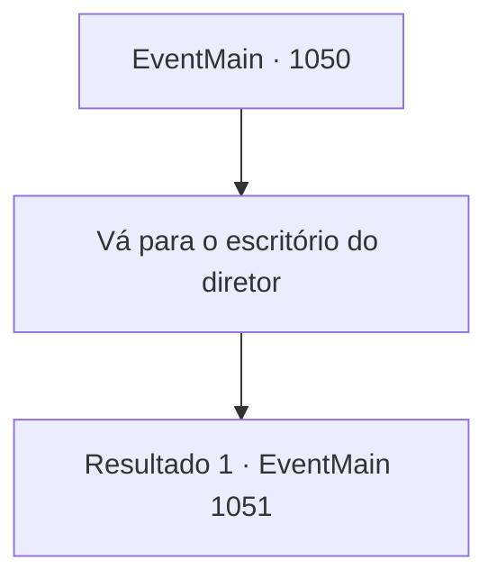

# Eventos principais · 1050

[Índice da tabela](index.md) · [Índice geral](../index.md)

ID: `pt:EventMain:1050` · Fonte: `EventMain4` · Versão: 1.2.47.

Mapeamento estático dos arquivos; a disponibilidade e a execução dependem do estado da run.

## Texto do evento

Depois de uma longa viagem, finalmente você chega a 'Viles', a cidade onde está localizada a Universidade de Brikkalua. Felizmente, o lugar parece tão pacífico quanto o dia em que você partiu. Você vai para o campus para encontrar Rosilpha e Naverr. Você encontra Rosilpha na praça principal. Ela te saúda calorosamente e fala. 

 "Que alegria te ver de novo! Eu estava te esperando, não estou exatamente familiarizada com a geografia local aqui."

 Ela acrescenta que ainda não viu Naverr.

## Dados de entrada

```json
{
  "id": 1050,
  "grade": 1,
  "normalGoal": "",
  "required": "13_5_11|1_2_100"
}
```

## Mapa das escolhas



## Escolhas e resultados

### Escolha 1

Vá para o escritório do diretor

Requisitos e outros campos da escolha:

```json
{
  "required": ""
}
```

#### Resultado 1.1

Você vai para o escritório do Diretor. Se Naverr de fato veio, esse seria o primeiro lugar para onde ele foi. No entanto, o Diretor responde, confuso. 

 "O que você quer dizer com 'Naverr veio aqui'? Ele nunca apareceu. ...Parece que você também não o encontrou ainda."


Continuação registrada: [Evento 1051](1051.md) na mesma tabela.

```json
{
  "required": "",
  "chance": "1",
  "nextEvent": 1051,
  "type": 2,
  "reward": ""
}
```

## Referências que chegam a este evento

Nenhum `nextEvent` positivo da mesma tabela aponta para este nó. Isso não prova que seja inacessível: sorteio e estado de história podem selecioná-lo.

