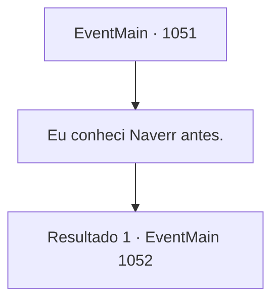

# Eventos principais · 1051

[Índice da tabela](index.md) · [Índice geral](../index.md)

ID: `pt:EventMain:1051` · Fonte: `EventMain4` · Versão: 1.2.47.

Mapeamento estático dos arquivos; a disponibilidade e a execução dependem do estado da run.

## Texto do evento

*Sem texto no arquivo.*

## Dados de entrada

```json
{
  "id": 1051,
  "grade": 1,
  "normalGoal": "",
  "required": ""
}
```

## Mapa das escolhas



## Escolhas e resultados

### Escolha 1

Eu conheci Naverr antes.

Requisitos e outros campos da escolha:

```json
{
  "required": ""
}
```

#### Resultado 1.1

Você conta ao Diretor tudo o que aconteceu com você e Naverr. Depois de ouvir você por alguns minutos, o Diretor murmura para si mesmo. 

 "O problema em nossas mãos é muito, muito mais sério do que eu temia, parece..."

 Ele enxuga o suor do rosto e suspira. 

 "*suspiro*... O que fazer, o que fazer... Deveríamos visitar a família dele primeiro? A Guilda dos Aventureiros, talvez...?"

 Você deixa o Diretor às suas reflexões e sai de seu escritório.

Continuação registrada: [Evento 1052](1052.md) na mesma tabela.

```json
{
  "required": "",
  "chance": "1",
  "nextEvent": 1052,
  "type": 2,
  "reward": ""
}
```

## Referências que chegam a este evento

- [Evento 1050 · escolha 1 · resultado 1](1050.md#escolha-1)
