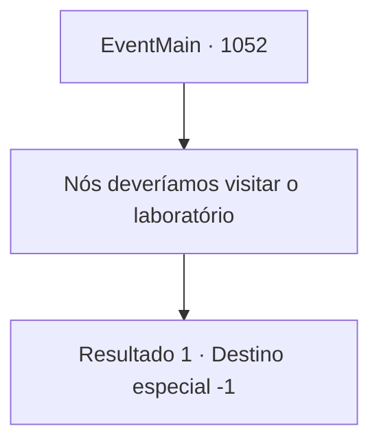

# Eventos principais · 1052

[Índice da tabela](index.md) · [Índice geral](../index.md)

ID: `pt:EventMain:1052` · Fonte: `EventMain4` · Versão: 1.2.47.

Mapeamento estático dos arquivos; a disponibilidade e a execução dependem do estado da run.

## Texto do evento

*Sem texto no arquivo.*

## Dados de entrada

```json
{
  "id": 1052,
  "grade": 1,
  "normalGoal": "",
  "required": ""
}
```

## Mapa das escolhas



## Escolhas e resultados

### Escolha 1

Nós deveríamos visitar o laboratório

Requisitos e outros campos da escolha:

```json
{
  "required": ""
}
```

#### Resultado 1.1

Você sai do escritório do Diretor e segue para o laboratório de pesquisa de Naverr. O lugar está vazio. Seu estado é exatamente o mesmo que antes de você sair - exceto por estar mais empoeirado. 

 "...O que fazemos agora?"

 Você não consegue responder a Rosilpha. Em vez disso, o som de metal rangendo ecoa pelos corredores.

Continuação registrada: [Destino especial `-1`](../destinos-especiais.md).

```json
{
  "required": "",
  "chance": "1",
  "nextEvent": -1,
  "type": 2,
  "reward": "15_6_0"
}
```

## Referências que chegam a este evento

- [Evento 1051 · escolha 1 · resultado 1](1051.md#escolha-1)
